# Phrabbit ユーザーガイド

Phrabbit は、外国語のリスニング練習のための A/B 区間リピートアプリです。音声ファイル、動画ファイル、ミュージックライブラリの曲、ポッドキャスト、YouTube リンクを学習素材として追加し、聞きたい区間だけを繰り返したり、自分の声でシャドーイングしたり、ディクテーションで書き取ったりできます。音声テキスト変換、単語帳、保存した録音やディクテーション履歴、学習記録も利用できます。

> 注: このガイドのボタン名は、アプリ内の英語 UI を基準に記載しています。端末の言語設定によって、一部の文言は日本語で表示される場合があります。

このガイドは**Phrabbit 4.0.0**を対象とします。プレーヤーの配置はiPhone・iPadのウインドウ幅に合わせて変わります。

## 目次

1. [はじめに](#1-はじめに)
2. [ホーム画面とライブラリ](#2-ホーム画面とライブラリ)
3. [学習素材を追加する](#3-学習素材を追加する)
4. [オーディオプレーヤー](#4-オーディオプレーヤー)
5. [A/B 区間リピート](#5-ab-区間リピート)
6. [ブックマークとリピート一覧](#6-ブックマークとリピート一覧)
7. [音声テキスト変換（STT）字幕](#7-音声テキスト変換stt字幕)
8. [字幕の編集、翻訳、手動追加](#8-字幕の編集翻訳手動追加)
9. [単語帳](#9-単語帳)
10. [YouTube ストリーム練習](#10-youtube-ストリーム練習)
11. [動画ファイルの練習](#11-動画ファイルの練習)
12. [シャドーイング録音と比較](#12-シャドーイング録音と比較)
13. [ディクテーション](#13-ディクテーション)
14. [ポッドキャスト](#14-ポッドキャスト)
15. [学習記録と設定](#15-学習記録と設定)
16. [無料版とプレミアム](#16-無料版とプレミアム)
17. [よくある質問](#17-よくある質問)

## 1. はじめに

### 1-1. 初回起動 - オンボーディング
アプリを初めて開くと、Phrabbit の基本的な流れを紹介する画面が表示されます。

1. **波形と A/B 区間リピート** - 音を目で見ながら開始点 A と終了点 B を指定し、その区間を繰り返します。
2. **字幕、単語帳、復習の流れ** - 字幕を読み、覚えたい単語を保存し、学習記録を積み重ねます。

最後の画面では、次のどちらかを選べます。

| ボタン | 説明 |
|---|---|
| **Try with a sample** | サンプル音声を開き、プレーヤーのチュートリアルを試します |
| **Skip** | すぐにホーム画面へ移動します |

### 1-2. 無料トライアル
オンボーディング後、**3日間の無料トライアル** が始まります。トライアル期間中はプレミアム機能を自由に試せます。トライアル中はプレーヤー上部に **Trial** バナーが表示され、タップするとプレミアム購入画面を開けます。

## 2. ホーム画面とライブラリ

ホーム画面は、追加した学習素材が集まる場所です。ローカル音声、動画ファイル、ミュージックライブラリの曲、ポッドキャストエピソード、YouTube リンクが同じライブラリ一覧に表示されます。

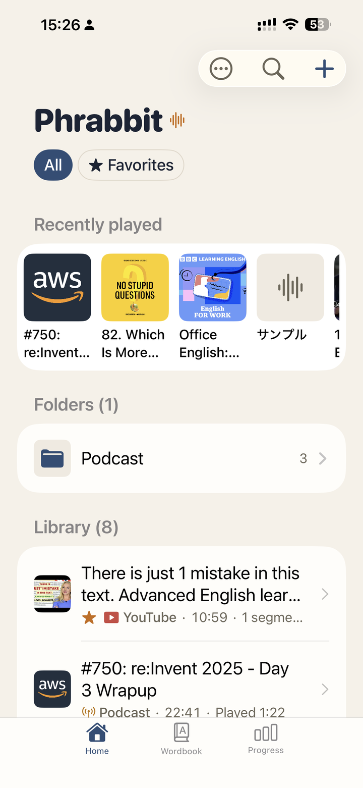
*▲ ファイル、ポッドキャスト、YouTube をまとめて表示するホーム画面*

### 2-1. 画面構成

| 位置 | 要素 | 説明 |
|---|---|---|
| ヘッダー | Phrabbit ワードマーク | リストを下へスクロールするとコンパクトなタイトルに変わる |
| 右上 | プラスボタン | 追加メニューを開く |
| 右上 | 検索ボタン | ライブラリ検索を開く |
| 右上 | その他ボタン | 設定とライブラリ整理のコマンドを開く |
| ワードマークの下 | All / Favorites | お気に入りが 1 件以上あると表示されるフィルター |
| 中央上 | Recent | 最近練習した項目が 2 件以上あると表示 |
| 中央 | Library | すべての学習素材を表示 |
| 下部 | Home / Wordbook / Progress | ホーム、単語帳、学習記録タブ |

初回利用時やライブラリが空のときは、中央の **Add** ボタンからすぐに素材を追加できます。素材が 1 件以上になると、プラスボタンの位置を知らせる小さなヒントが一度表示されることがあります。設定は独立した歯車ではなく **その他** ボタンの中にあります。

### 2-2. お気に入りとフォルダ
ライブラリ行の末尾にある **⋯** をタップするか、行を長押しすると、同じ管理メニューが開きます。**Add to Favorites** でお気に入りに追加したり、**Move to Folder…** で整理したりできます。通常のライブラリ項目で **Info** を選ぶと、完全なタイトル、種類、長さ、再生位置、追加日または区間数、フォルダの場所など、行に収まらない情報を確認できます。フォルダのメニューには **Rename**、**Move to Folder…**、**Delete** が表示されます。

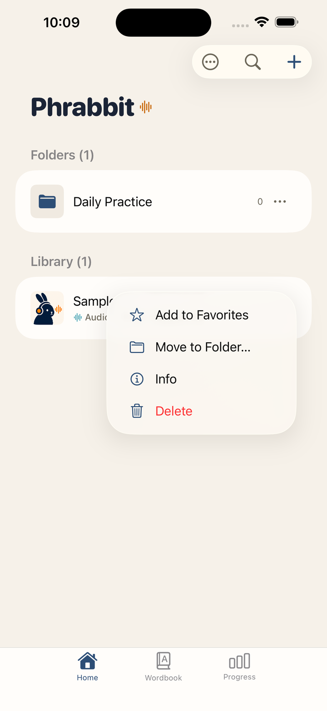
*▲ 表示された ⋯ と長押しは同じメニューを開きます*

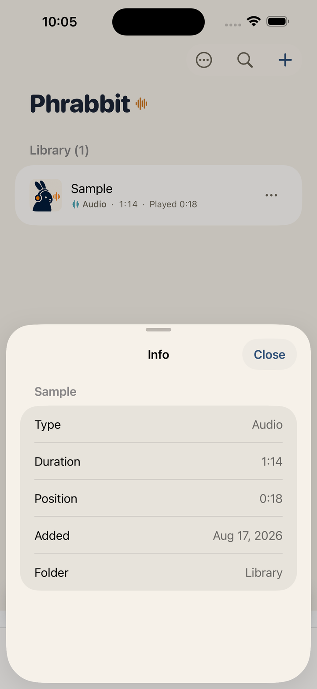
*▲ Info は行に収まらない情報を表示します*

お気に入りが 1 件以上あるとワードマークの下に **All / Favorites** チップが表示されます。**Favorites** を選ぶと、フォルダに関係なくライブラリ全体のお気に入りだけが表示されます。

**その他 > New Folder** でフォルダを作成します。フォルダがある場合は **その他 > Select** で複数の項目を選んでまとめて移動できます。選択中は左上の **Select All** で、いま表示している一覧のファイルとフォルダをすべて選べます。もう一度タップすると（**Deselect All**）すべて解除されます。フォルダを移動すると、中の項目も一緒に移動します。**All Items** でライブラリ全体を 1 つの一覧で開けます。フォルダの中に別のフォルダを作ることもできます。

検索結果も選んで移動できます。検索語を入力してから **その他 > Select**（**All Items** では右上の **Select**）をタップすると、複数のフォルダに散らばった結果をまとめて選び、1 つのフォルダへ移動できます。まだフォルダがなくても、移動先を選ぶ画面で新しいフォルダを作れます。検索語を変えると選択はリセットされます。

### 2-3. 項目の種類
一覧のアイコンやサムネイルで素材の種類を見分けられます。

- **波形アイコン** - ファイルアプリから読み込んだ音声
- **音符アイコン** - ミュージックライブラリから読み込んだ曲
- **アンテナアイコン** - ポッドキャストエピソード
- **YouTube サムネイルまたは再生アイコン** - YouTube ストリーム
- **フィルムアイコンまたは動画サムネイル** - 端末にある動画ファイル

項目をタップすると対応するプレーヤーが開きます。音声はオーディオプレーヤーで、YouTube は Stream プレーヤーで、動画は動画プレーヤーで開きます。

### 2-4. 削除
ライブラリ行の末尾にある **⋯** をタップするか、行を長押しして **Delete** を選びます。スワイプしても管理操作は表示されません。**⋯** と長押しは常に同じメニューを表示します。

削除すると、その素材に関連する波形キャッシュ、ブックマーク、字幕、保存済みシャドーイング録音、ディクテーション履歴も一緒に整理されます。保存済み録音がある項目では、削除前に確認画面が表示されます。フォルダを削除するときは、フォルダだけを削除するか、中の素材も一緒に削除するかを選べます。

### 2-5. 並び順の設定

ホーム画面やフォルダ内で、右上の **その他（⋯）> Sort By** を開くと、ライブラリの並び順を選べます。選択中の基準と方向にはチェックマークが付きます。

| 並び替えの基準 | 説明 | 選択時の初期方向 |
|---|---|---|
| **Recently Played** | 最近再生・使用した日時順。既定の基準です | **Newest First** — 最近のものから |
| **Date Added** | ライブラリに追加した日付順 | **Newest First** — 新しいものから |
| **Name** | 名前順 | **A to Z** — 昇順 |
| **Duration** | 素材全体の長さ順 | **Shortest First** — 短いものから |

基準の下には 2 つの方向が表示されます。日付では **Newest First / Oldest First**（新しい順／古い順）、名前では **A to Z / Z to A**（昇順／降順）、長さでは **Shortest First / Longest First**（短い順／長い順）を選べます。チェックの付いた基準をもう一度タップしても方向が反転します。別の基準を選ぶと、上の表の初期方向になります。

設定は保存され、**ホーム、すべてのフォルダ、検索結果、All Items** に共通で適用されます。フォルダごとに設定する必要はありません。上部の **Recent** は、この設定に関係なく最近のものから表示されます。

フォルダは常に素材より上に表示されます。**Name** では選択した名前の方向、**Date Added** ではフォルダの作成日と選択した方向に従います。**Recently Played** と **Duration** ではフォルダは名前の昇順になります。一度も開いていない YouTube リンクなど、長さがまだ分からない素材は、**Duration** のどちらの方向でも素材一覧の末尾に表示されます。

## 3. 学習素材を追加する

ホーム画面右上のプラスボタンをタップすると、追加メニューが開きます。

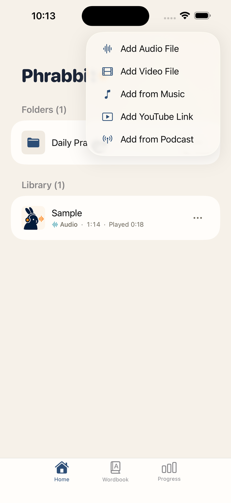
*▲ ファイル、音楽、YouTube リンク、ポッドキャストを追加するメニュー*

### 3-1. オーディオファイルを追加
**Add Audio File** をタップすると、システムのファイルピッカーが開きます。mp3、m4a、wav、aac などの音声ファイルを読み込めます。複数ファイルを同時に選択することもできます。読み込んだファイルはアプリの Documents 領域にコピーされ、ライブラリに追加されます。

### 3-2. 動画ファイルを追加
**Add Video File** をタップすると、端末や iCloud Drive にある動画を選べます。MP4、M4V、MOV ファイルを使用でき、無料で使える機能です。

動画ファイルはアプリ内にコピーされません。Phrabbit は元ファイルへのリンクだけを保存するため、元のファイルを移動したり削除したりすると再生できなくなります。詳しくは [11. 動画ファイルの練習](#11-動画ファイルの練習) を参照してください。

### 3-3. ミュージックライブラリから追加
**Add from Music** をタップすると、端末に保存されている音楽一覧が開きます。

- すでに Phrabbit に追加済みの曲にはチェックが表示されます。
- Apple Music サブスクリプションでダウンロードした曲は DRM のため読み込めません。
- 直接購入した曲や CD から変換した DRM なしの曲のみ使用できます。

曲をタップすると、アプリで再生できる形式に準備されたあとライブラリに追加され、そのままプレーヤーが開きます。

### 3-4. YouTube リンクを追加
**Add YouTube Link** をタップすると、YouTube リンク入力画面が開きます。

1. YouTube アプリまたはブラウザで動画の **Share** をタップします。
2. **Copy Link** をタップします。
3. Phrabbit に戻り、**Paste** をタップします。
4. サムネイルを確認し、**Add** をタップします。

映像はYouTube埋め込みプレーヤーでストリーミングし、アプリにダウンロードしません。リンク、再生位置、ブックマーク、録音、ディクテーション記録と、読み込み・保存した字幕カード、編集、翻訳は端末に保存されます。

### 3-5. ポッドキャストを追加
**Add from Podcast** はプレミアム機能です。プレミアムまたは無料トライアル中は、番組名で検索したり、練習言語別のおすすめを見たり、Apple Podcasts の購読一覧や RSS アドレスからエピソードを読み込んだりできます。無料トライアル終了後はメニューにロックが表示され、タップするとプレミアム画面が開きます。

詳しくは [14. ポッドキャスト](#14-ポッドキャスト) を参照してください。

## 4. オーディオプレーヤー

ホーム画面で音声項目をタップすると、全画面プレーヤーが開きます。

*▲ 波形と文ごとのカードを同じ画面で表示するオーディオプレーヤー*

### 4-1. 閉じる操作とミニプレーヤー

| 方法 | 説明 |
|---|---|
| 左上の下向き矢印 | プレーヤーを閉じてホームへ戻ります |
| 画面上部から下へスワイプ | プレーヤーを手で下げて閉じます |

音声が読み込まれた状態でプレーヤーを閉じると、ホーム画面下部にミニプレーヤーが表示されます。ミニプレーヤーをタップすると、全画面プレーヤーに戻ります。

プレミアムユーザーが **Settings > Playback > Background playback** をオンにしている場合、画面ロック中やバックグラウンドでも音声を再生し続けられます。無料ユーザー、またはこの設定をオフにしているユーザーは、アプリがバックグラウンドへ移動すると音声が一時停止します。

### 4-2. 波形エリア
波形は音声を時間軸で表示します。縦の再生線が現在位置を示し、字幕がある場合は短い目盛りで文の境界を確認できます。タップで移動、長押しでA/Bを設定し、ハンドルをドラッグして調整します。ハンドルは文の境界に吸着せず自由に動かせます。

- 波形横の**ズームタイル**を押すと、1行の長さが3・5・8・10秒に切り替わります。ピンチでは2〜15秒の範囲で細かく調整できます。**7.5s**は1行が7.5秒であることを示します。
- 手動スクロールで別の位置を確認できます。**Current Position（◎）**で、再生位置を変えずに波形と字幕カードを現在位置へ戻せます。
- 字幕がない場合、波形は空き領域まで広がります。大きい画面では再生中の行の下に次の行も表示されます。

### 4-3. タブと再生ツール
上部で**Subtitles / Bookmarks / My Recordings / Dictation**を切り替えます。iPhoneはアイコン、幅の広いiPadでは件数も表示します。非常に狭いウインドウではタブメニューを使います。音声タイトルを押すと情報が開き、その横にスリープタイマーがあります。

固定ツール列には左から次のボタンが並びます。

| 操作 | 機能 |
|---|---|
| 再生／一時停止 | 再生を開始・停止 |
| **A-B** | A設定 → B設定 → Aへ戻る |
| 反復回数 | 無制限、1・2・3・5・10回 |
| 再生速度 | 0.5×・0.75×・1×・1.25×・1.5×・2× |
| シャドーイング間隔 | 反復の間に話すための無音を入れる |
| ブックマーク保存 | 現在のA/B区間をすぐ保存 |
| 練習 | ShadowingまたはDictationを開く |

ツール上のシークバーでファイル全体を移動し、**−5 / +5**で5秒ずつ移動します。波形横の**×**は区間解除、**±**は微調整です。区間が必要なツールはA/B設定前には薄く表示されます。

スリープタイマーは5・15・30・60分後に再生を止め、設定中は残り時間を表示します。バックグラウンド利用はPremiumとBackground playback設定に従います。字幕は空の**Subtitles**タブで作成し、カードがあるときは右下の**···**で字幕設定を開きます（7章）。

幅の広いiPad横向きウインドウでは、画面全幅のタイトルバーが両パネルの上にあり、音声タイトルとスリープタイマーが表示されます。左に波形とツール、右パネルの最上部にタブ、その下にリストが並びます。縦向きや狭いウインドウは1列です。

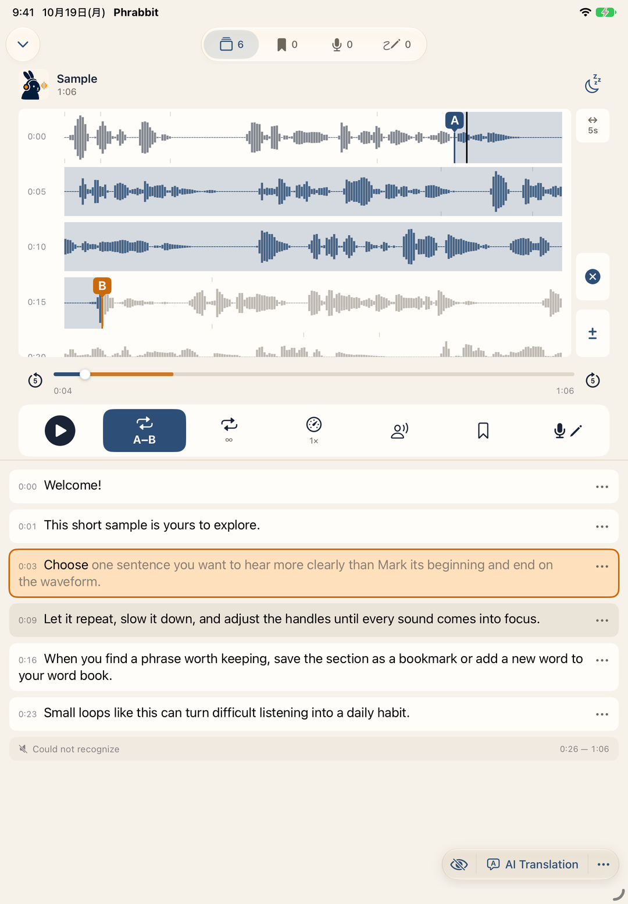

ダークモードの画面

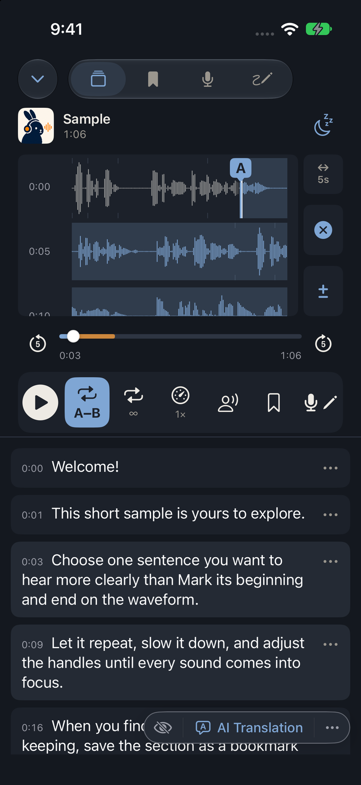

## 5. A/B 区間リピート

A/B 区間リピートは、聞きたい一文や短い表現を繰り返すための中心機能です。

*▲ 指先で A/B 区間を合わせて繰り返す画面*

### 5-1. A-B ボタンで設定
1. 繰り返したい開始位置で **A-B** をタップします。この位置が A になります。
2. 終了位置でもう一度 **A-B** をタップします。この位置が B になり、リピートが始まります。
3. 区間設定後に **A-B** をタップすると、A 位置へ戻ります。

状態によってボタンの見た目が変わります。

| 状態 | 意味 |
|---|---|
| A-B | まだ区間がありません |
| A→B | A のみ設定済み、B を待っています |
| 塗りつぶし A-B | A と B が設定され、リピート中です |

A のみ設定されている状態では、**Tap A-B again to set the end** という案内が表示されます。誤って A だけ設定した場合は、案内右側の閉じるボタンでキャンセルできます。

### 5-2. 波形で正確に設定
波形の任意の位置を長押しすると、A/B ポイントを設定できます。A と B のハンドルを指でドラッグして、位置をさらに細かく合わせられます。

### 5-3. 区間の微調整と解除
波形横の**±**で開始・終了を**0.1秒単位**で微調整できます。**×**でA/Bを解除でき、Aのみの状態も取り消せます。Streamと動画では同じボタンが時間ルーラーの両側にあり、**0.5秒単位**で調整します。

シャドーイングとディクテーションは固定ツール列の**Practice**から開きます。文カードをスクロールしてもツールは使えます。

### 5-4. シャドーイング間隔
**Shadowing gap**ボタンは固定ツール列にあり、A/B設定後に使えます。 このボタンをオンにすると、リピートの間に短い無音時間が入り、直前に聞いた文を自分で言ってみることができます。録音しなくても使える無料の練習機能です。

無音時間中は **Speak** のカウントダウンが表示されます。

## 6. ブックマークとリピート一覧

ブックマークは、よく練習したい A/B 区間を保存する機能です。

### 6-1. ブックマークを保存
1. 先に A/B 区間を設定します。
2. 固定ツール列の**Save**を押します。
3. 区間が自動名で保存され、**Bookmark saved** トーストが表示されます。
4. すぐに名前を付ける場合はトーストの **Rename** をタップします。ブックマーク一覧から後で名前を変更することもできます。

自動名はファイルのタイトルと区間の長さを基に作成されます。同じ区間を再度保存しようとしても、重複保存はされません。

### 6-2. ブックマーク一覧
現在のファイルの**Bookmarks**タブを開きます。ブックマークを押すとA/B区間を復元して再生します。**My Recordings**と**Dictation**はそれぞれのタブで確認でき、記録がなくてもタブは表示されます。

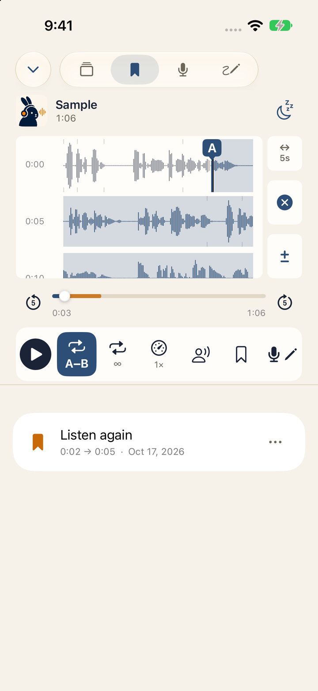
*▲ ブックマーク・録音・ディクテーションにはそれぞれ専用タブがあります*

上部のタブでブックマーク・録音・ディクテーション記録を切り替えます。幅の広いiPadの録音・試行数は、個別テイクではなく区間ごとのグループ数です。 音声ファイルに2件以上のブックマークがある場合、**Play All**で順番に再生し、各区間を1・2・3回反復できます。音声専用で、動画とYouTubeでは使えません。

ブックマーク行の末尾にある **⋯** をタップするか、行を長押しすると **Rename**、**Info**、**Delete** が表示されます。**Info** では正確な A/B 範囲、区間の長さ、保存日を確認できます。保存済み録音も同じ方法で **Info** または **Delete** を選べ、情報画面には範囲、長さ、同じ練習ポイントのテイク数、録音日が表示されます。スワイプしても管理操作は表示されません。

無料ユーザーは、オーディオファイルごとに新しいブックマークを 1 件まで作成できます。プレミアムまたは無料トライアル中は無制限に作成できます。プレミアムまたは無料トライアル期間中に保存したブックマークは、無料状態になったあとも一覧から開いて練習できますが、無料上限を超える新しいブックマークは追加できません。YouTube ストリームのブックマーク保存はプレミアム機能です。

## 7. 音声テキスト変換（STT）字幕

STT は、音声を文単位の字幕に変換する機能です。プレミアムまたは無料トライアル中に利用できます。

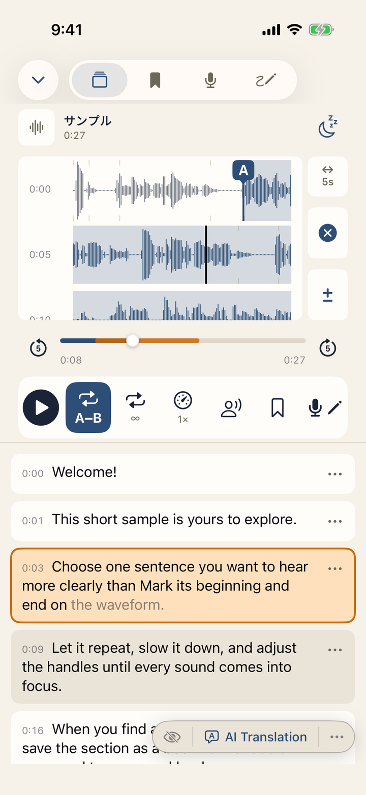
*▲ 音声を文単位の字幕カードに変換した画面*

### 7-1. 変換を開始

音声認識にはPremiumまたは無料体験が必要です。利用権限がない場合、**Convert speech to subtitles**に鍵マークが表示され、タップするとPremiumの案内が開きます。字幕の手入力は引き続き利用できます。

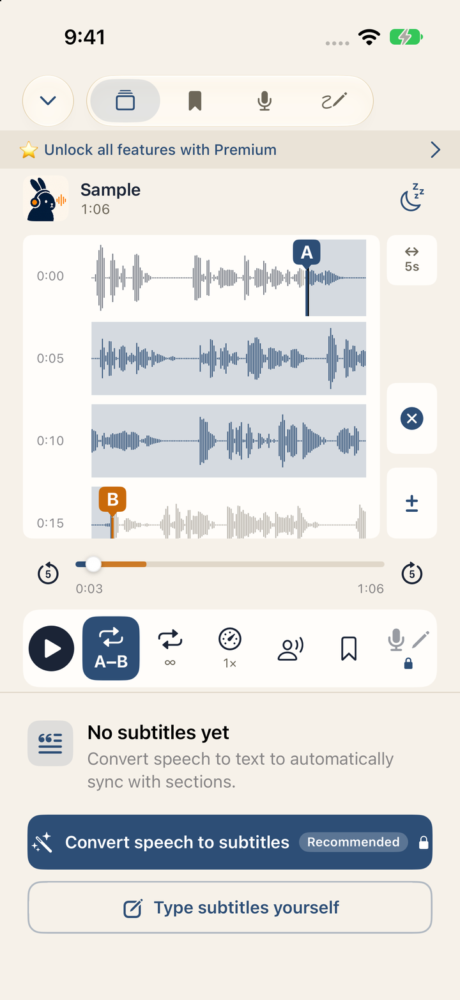

1. **Subtitles**タブを開き、字幕がなければ**Convert speech to subtitles**を押します。
2. 実際に話されている言語を押すと、選択画面が閉じて音声認識が始まります。

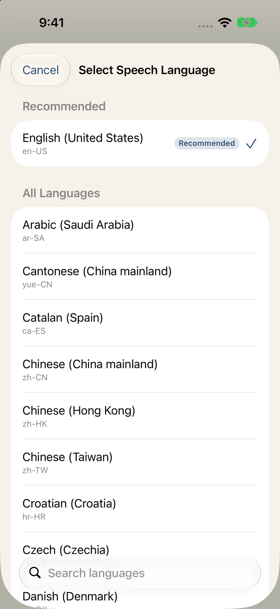
*▲ 推奨言語と最近使った認識言語*

推奨には以前の選択、ポッドキャストRSSの言語、タイトル、端末の言語などを使います。音声と合っているか確認してください。

字幕がすでにある場合は、右下の**···**で**Subtitles**設定シートを開きます。

- **Add Segment** — 字幕を手入力で追加。
- **Re-run with current language** — 現在の言語で再認識。
- **Change Language and Re-run** — 認識言語を変更。
- **Subtitle Info** — 認識の詳細を確認。
- **Delete Subtitles** — 音声認識で作った未編集の字幕を削除。時間だけを調整した文も削除されますが、手動追加・文章を編集した字幕と制作者の字幕は残ります。

再認識でも制作者の字幕と手動編集した文は保持されます。削除時には確認が表示されます。下部の独立した字幕ボタンと、長押しによる言語変更はなくなりました。

音声認識の再実行と認識字幕の削除はPremiumが必要です。保存字幕の閲覧と文の手入力は無料です。

**Subtitles**の設定画面は最初から全高で開きます。下の項目はスクロールして確認でき、必要なら画面を引き下げて半分の高さにできます。

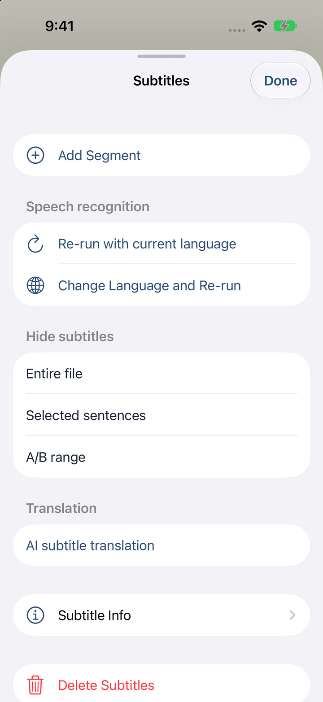

### 7-2. 変換中

変換中は **Converting...** または **Downloading language model...** の進行バーが表示されます。一部の言語では、初回利用時に端末内の音声モデルをダウンロードする場合があります。

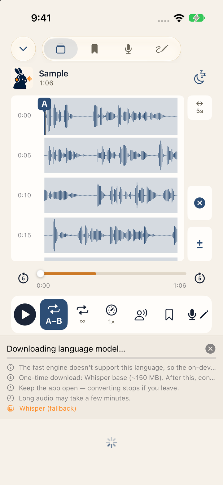
*▲ 変換中は進行バーと、アプリを開いたままにする案内が表示されます*

重要な点:

- 変換中はアプリを開いたままにしてください。アプリを離れたり画面をロックしたりすると、変換が中断されることがあります。
- 長い音声は数分かかる場合があります。
- キャンセルすると今回の変換は中止され、既存の字幕は維持されます。
- モデルダウンロードや一部の復旧処理は Wi-Fi 設定の影響を受けます。
- 認識結果が空だった場合は **Trying another recognition method…** と表示され、別の認識方法でもう一度試します。それでも字幕を作成できない場合は、音声が正しく再生されるか、選んだ言語が合っているかを確認するよう案内が表示されます。ファイルを最後まで読み込めなかった場合は、もう一度ダウンロードまたは読み込むよう案内されます。

### 7-3. 変換結果を見る
変換が終わると、字幕カードが時間順に表示されます。

各カードには次の情報が表示される場合があります。

- 開始時刻
- 字幕の出所表示
- 信頼度が低い場合の警告
- **Approx. position** バッジ: テキストは認識されたが位置が概算の場合
- 字幕本文
- **⋯** メニューの **Translate**、**Add to Wordbook**、**Edit**、**Delete** — カードを長押ししても同じメニューが開きます

字幕カードをタップすると、そのカードの区間が A/B に設定され、すぐにリピート再生されます。現在再生中のカードは強調表示され、A/B 区間内のカードは背景色が変わります。単語タイミングを含む新しい音声認識字幕では、再生位置に合わせて発話済みの単語まで順に明るくなります。以前に作成した字幕や読み込んだ字幕には単語タイミングがないため、この効果が表示されない場合があります。

手動スクロールを終えた後、再生が画面内の字幕カードに到達すると、自動追従が再開します。**Current Position（◎）**で音声の波形と字幕カードをすぐに現在の再生位置へ戻せます。隠す文を選んでいる間は追従しません。

### 7-4. 認識できなかった区間
無音または認識が難しい区間は **Could not recognize** カードとして表示される場合があります。このカードは案内用です。その区間に字幕を直接入れるには、再生位置をその区間に移してから **Add Segment** をタップしてください（8-1 参照）。

### 7-5. 字幕情報を見る
右下の**··· > Subtitle Info**で、変換日時、認識エンジン、品質に関する案内、単語時刻情報の有無を確認できます。自動字幕は誤ることがあるため、大切な表現は確認して編集してください。

### 7-6. 字幕を隠す
字幕カード右下に浮かぶ目ボタンで文字を隠す・表示する操作ができます。隠れたカードも開始時刻と**Subtitle hidden**を表示し、押すと文を反復します。**··· > Hide subtitles**で**Entire file / Entire video**、**Selected sentences**、**A/B range**を選びます。文を選ぶ場合はカードを押してチェックし、**Done**で終えます。A/B範囲は区間の変更に合わせて更新されます。

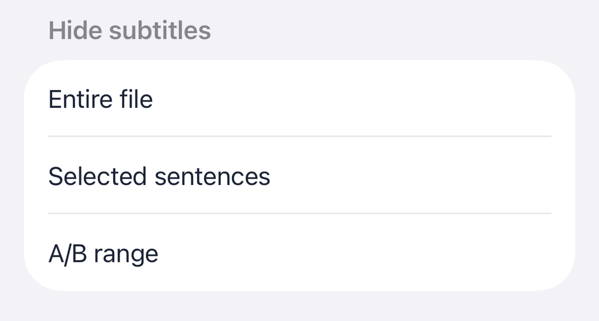

音声・ローカル動画・YouTubeの字幕カードで使えます。同じプレーヤー内のタブ切り替えでは保持され、閉じると初期化されます。まず聞いて、目ボタンで文を確認してください。全画面字幕パネルも通常画面の状態を共有し、範囲や対象文は通常画面で選びます。

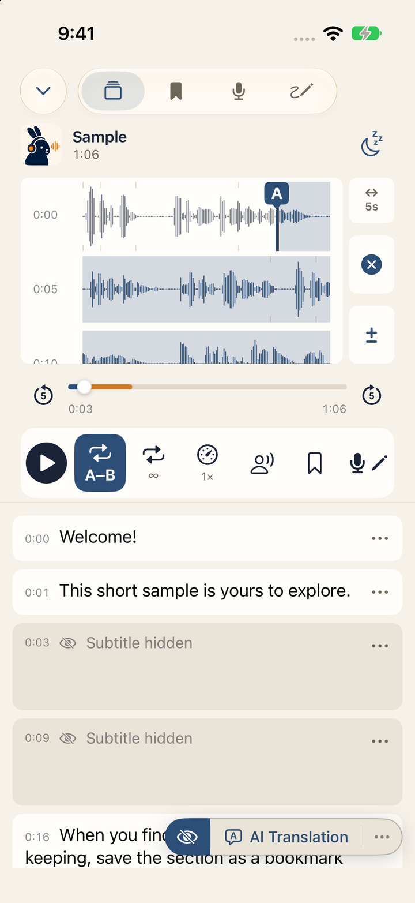

## 8. 字幕の編集、翻訳、手動追加

### 8-1. 字幕を手動で追加
音声のSubtitlesタブで**··· > Add Segment**を開きます。字幕がない場合は**Type subtitles yourself**を選びます。 現在の再生位置から5秒間の新しい区間で編集画面が開きます。上部の **Adjust timing** で波形を見ながら開始・終了のハンドルをドラッグするか、**Start**・**End** の横のボタンで 0.1 秒ずつ調整し、再生ボタンでその区間だけを試聴できます（8-2 参照）。その後、テキストを直接入力します。

音声をもう一度認識させるには、**Recognition language** で言語を確認し、**Recognize again** をタップします。結果は先にプレビューとして表示され、入力中の内容を自動で上書きしません。使いたい結果なら **Put in editor** で編集欄に入れ、必要な修正をしてから画面上部の **Add** をタップして保存します。

### 8-2. 字幕を編集
字幕カードの **⋯** をタップするか、カードを長押しして **Edit** を選ぶと、編集画面が開きます。テキストだけでなく、その文の開始・終了時刻も修正できます。

- **Adjust timing** - 波形上の開始・終了ハンドルをドラッグするか、**Start**・**End** の横の −/+ ボタンで 0.1 秒ずつ動かします。波形の下のボタンで前後の音声を表示したり、拡大・縮小したりでき、中央のボタンで文の区間に合わせて表示し直せます。再生ボタンをタップすると、調整した区間だけを再生します。
- **Adjacent sentence timing changes** - 境界を広げて前後の文と重なると、重なった分だけ隣の文が短くなり、その変化がこの欄にプレビュー表示されます。あとで境界を戻すと、借りた部分は隣の文に返されます。最初から重なっていた隣の文は変わりません。
- **Restore original range** - タイミングを変えると **Original range** に元の区間が表示され、このボタンでいつでも元に戻せます。前後の文の現在の境界のために元の区間に戻せない場合は、手動で調整するよう案内が表示されます。
- **Restore original text** - STT で作成した字幕のテキストを修正すると元のテキストも表示され、このボタンで元に戻せます。

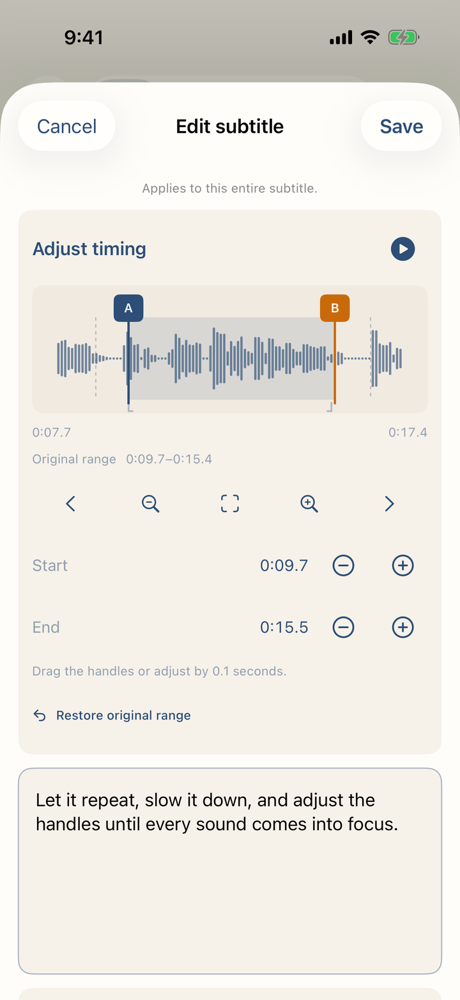
*▲ 波形ハンドルと0.1秒ボタンで時刻を調整し、元の区間に戻せます。*

編集画面でも **Recognize again** で設定中の区間だけを再認識し、プレビューを **Put in editor** で編集欄へ移せます。タイミングもテキストも、画面上部の **Save** をタップするまで保存されません。

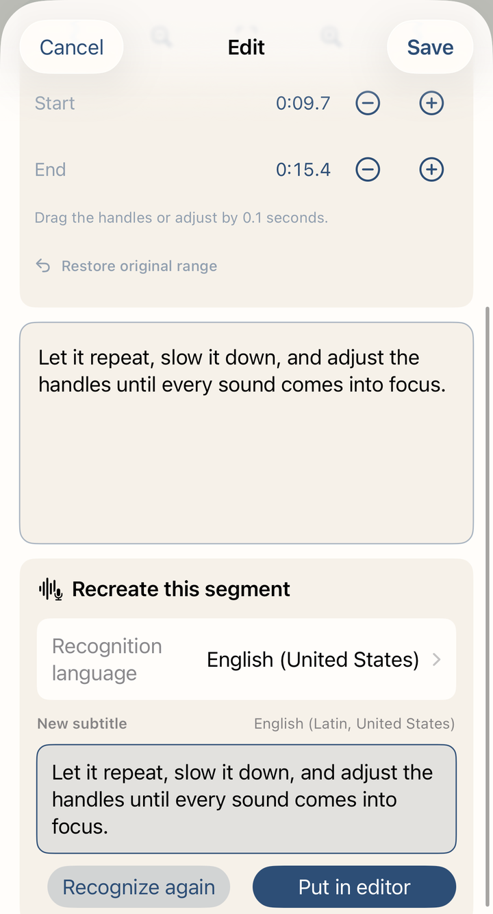
*▲ 再認識の結果はプレビューとして表示され、編集中の内容はそのまま残ります*

### 8-3. 字幕全体を翻訳
iOS 26.4以降のApple Intelligence対応端末では、右下の翻訳ボタンまたは**··· > Translation**から**AI Translation**を開始できます。Premiumまたは無料体験が必要です。字幕言語は自動判定され、**Subtitle language**に表示されます。**Translation language**で対応する翻訳先言語を選び、対象を確認して**Start translation**を押します。音声・字幕はアップロードされず、保存した結果は再度開くときも使えます。音声・ローカル動画・読み込み済みYouTube字幕で同じ操作を使います。

翻訳中は進行状況が表示されます。アプリやプレーヤーを閉じると安全に一時停止し、後で **Continue translation** から再開できます。長い素材は時間がかかり端末が暖かくなることがありますが、必要に応じて自動で速度を落とします。開始後には、その処理中だけ画面を消灯しない選択肢も案内されます。

吹き出しボタンは**Original only / Original + translation**を切り替えます。**··· > Translation**では**Translation only**の明示選択、言語変更、翻訳の続行・再試行、保存済みAI翻訳の削除ができます。二言語動画字幕のファイル翻訳とAI翻訳は別のソースです（11-4）。

※ 例として、英語の字幕を日本語に翻訳します。**AI Translation**では、対応言語の中から希望する翻訳先言語を選べます。

翻訳を開始できない場合、設定画面の代わりに**AI translation unavailable**の通知で現在の原因が1つ表示されます。Apple Intelligenceがオフ、モデルの準備ができていない、字幕言語を判定できない、言語が非対応などの場合です。表示された原因を解消してから再試行してください。非対応端末や非対応のiOSではAI翻訳の入口は表示されません。機械翻訳は固有名詞、文化的な表現、専門用語を誤ることがあるため、重要な内容は原文と比較してください。

### 8-4. 1 文を翻訳
字幕カードの **⋯** から **Translate** を選ぶと、iOS のシステム翻訳画面が開きます。翻訳は学習補助用であり、文脈によって不正確な場合があります。

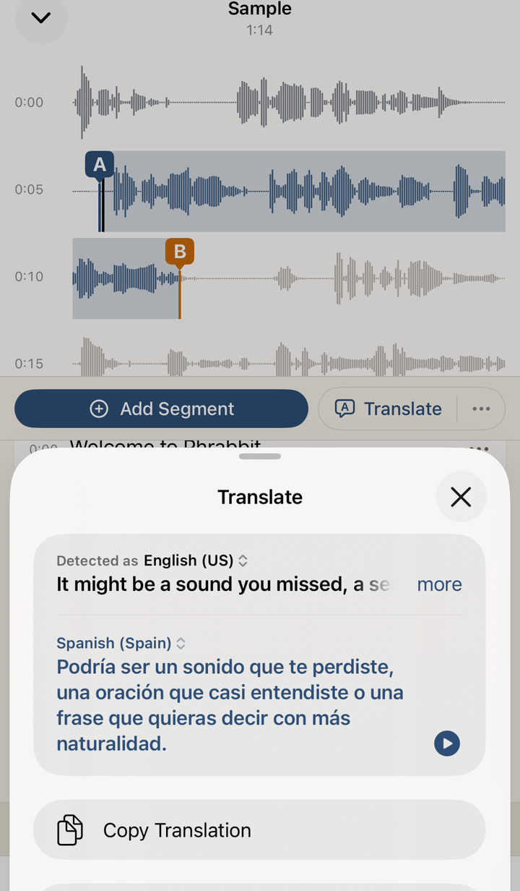
*▲ 字幕の文をその場で翻訳して確認する画面*

動画・YouTubeカードでは**Translate this sentence**と表示されます。システム画面で1文を翻訳し、素材の翻訳を保存する**AI Translation**とは別の操作です。

### 8-5. 単語帳に追加
字幕カードの **⋯** から **Add to Wordbook** を選ぶと、その文から単語や表現を選んで単語帳に保存できます。単語帳自体はプレミアム機能のため、無料トライアル終了後はプレミアム画面が開きます。

## 9. 単語帳

単語帳は、字幕カードから保存した単語や表現をまとめて復習する場所です。プレミアムまたは無料トライアル中に利用できます。

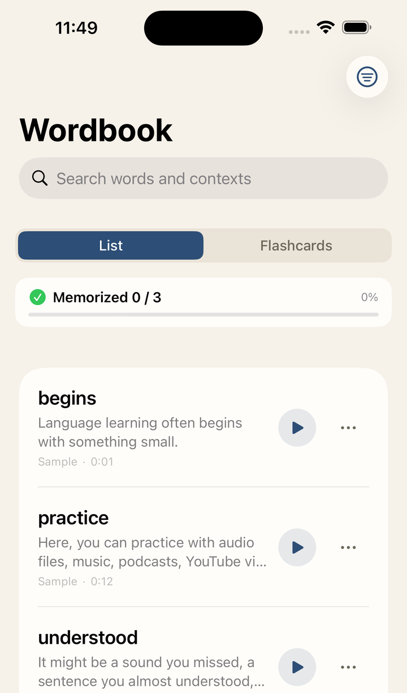
*▲ 文脈と一緒に表現を保存する単語帳*

### 9-1. 単語を保存
字幕カードの **⋯** から **Add to Wordbook** を選ぶと、この画面が開きます。

保存できる内容:

- 単語または表現
- 意味
- 学習文脈
- 文脈翻訳
- メモ
- Apple Intelligence の説明

文から自動抽出された単語チップを選ぶか、**Custom Input** に直接入力できます。英語のようにスペースがある言語は単語単位で表示され、日本語や中国語はアプリが再度トークン化して、より自然な単位で表示しようとします。

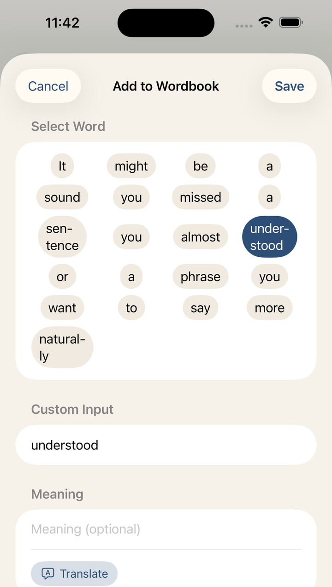
*▲ 字幕文から単語を選び、意味と学習文脈を保存する画面*

### 9-2. Translate で入力
**Meaning** と **Context Translation** には **Translate** ボタンがあります。タップすると iOS 翻訳機能で意味や文脈翻訳を入力できます。結果は保存前に自分で修正できます。

iOS 翻訳機能は、音声の言語と端末の言語が同じ場合、別の翻訳を作成しないことがあります。その場合は、意味や文脈翻訳を直接入力または修正してください。

### 9-3. Apple Intelligence の説明
Apple Intelligence を利用できる場合、**AI Explanation** セクションが表示されることがあります。**Generate Explanation** をタップすると、選択した単語がこの文脈でどのように使われているかの説明を生成します。

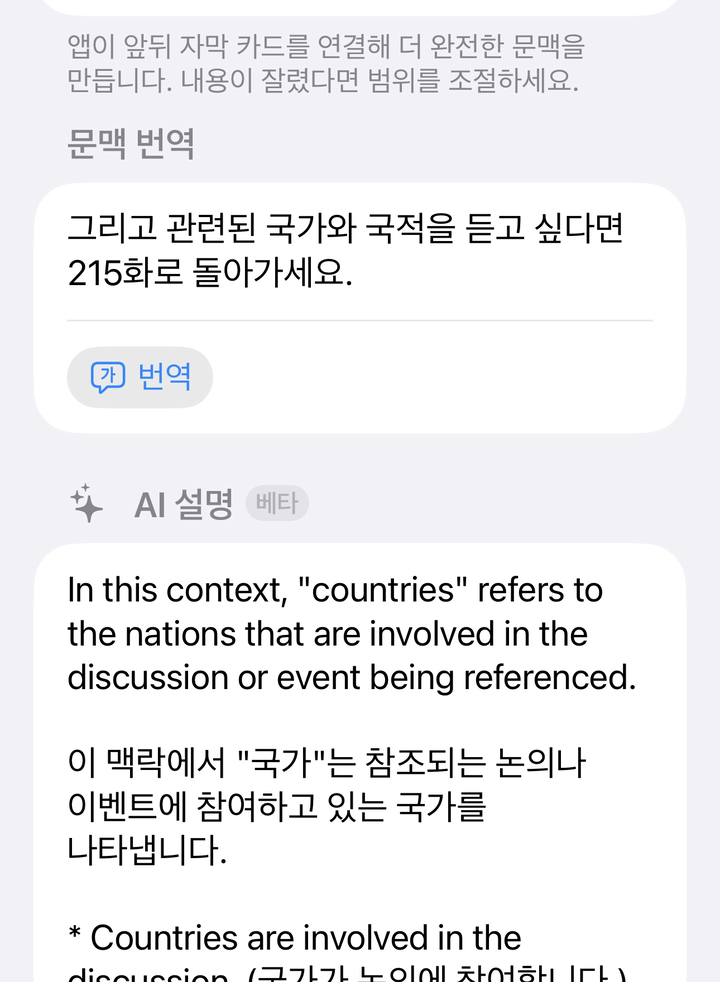
*▲ 選択した単語の文脈上の意味と例文を生成した AI Explanation*

※ 機能を説明するため、韓国語の画面と内容を例として使用しています。対応言語と利用条件は以下をご確認ください。

このセクションは、次の条件をすべて満たす場合にのみ表示されます。

- iOS 26 以降
- Apple Intelligence に対応した端末
- 端末設定で Apple Intelligence がオンになっており、モデルが準備済みであること
- 字幕言語、ポッドキャストの言語情報、または文のテキストから学習言語を判定できること
- 学習言語と端末言語が Apple Intelligence モデルでサポートされていること

同じ言語だからといって、AI 説明が必ず非表示になるわけではありません。ただし上記の条件のいずれかを満たさない場合、セクションは表示されません。また、**Translate** ボタンは iOS 翻訳機能の制限に従います。生成結果は端末上で作成されるベータ機能であり、誤ることがあります。保存前に自分で修正したり削除したりできます。

### 9-4. 一覧とフラッシュカード
単語帳タブでは 2 つのモードを使えます。

| モード | 説明 |
|---|---|
| **List** | 単語、意味、文脈、出所ファイル、再生位置を一覧で確認 |
| **Flashcards** | カードをめくりながら暗記練習 |

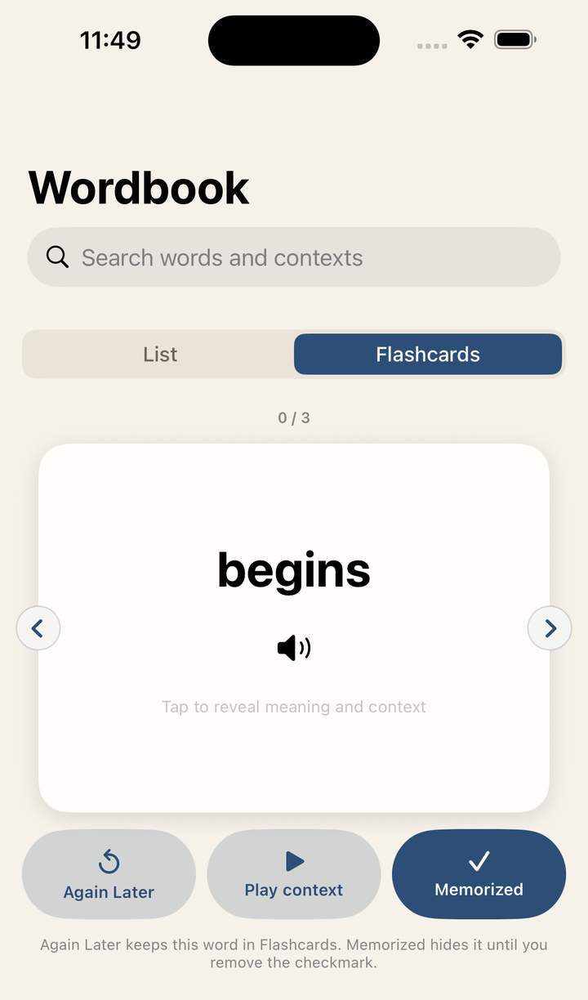
*▲ すき間時間にカードで復習する画面*

一覧の再生ボタンで保存した文脈をすぐに聞けます。行末の **⋯** をタップするか行を長押しすると、**Mark as Memorized** または **Resume Learning**、**Delete** が表示されます。単語詳細画面では追加日の確認、発音の再生、意味/メモの編集、元の音声を開く、辞書検索、Apple Intelligence 説明の再生成ができます。一覧で覚えた単語を非表示にするフィルターも使えます。

## 10. YouTube ストリーム練習

YouTube リンクを追加すると、Stream プレーヤーが開きます。YouTube 動画はアプリ内に保存されず、YouTube 埋め込みプレーヤーで再生されます。

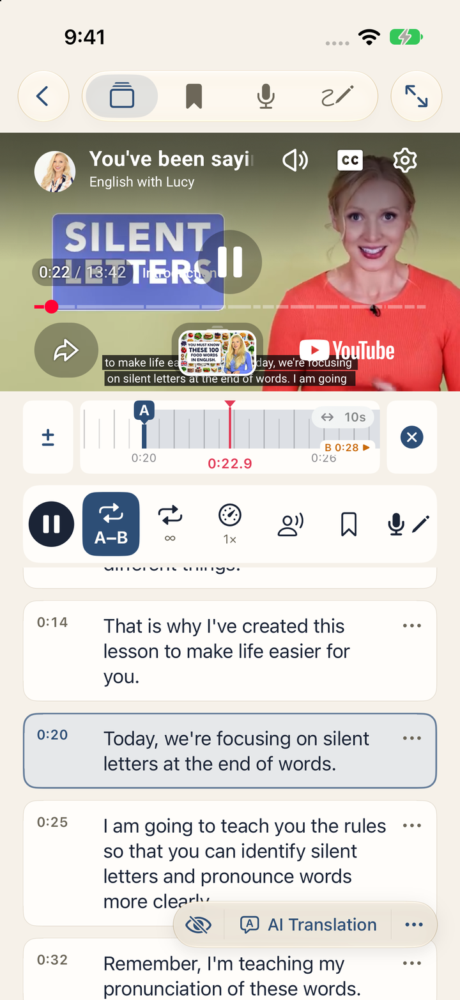
*▲ YouTube映像・固定ツール・字幕カードを一緒に表示します。*

### 10-1. 基本構造
YouTube映像の下に時間ルーラーと7つのツールが固定されます。左から再生／一時停止、A-B、反復回数、速度、シャドーイング間隔、ブックマーク保存、練習です。上部は**Subtitles / Bookmarks / My Recordings / Dictation**を切り替えます。リストだけがスクロールするため、字幕を読みながら区間を調整できます。

字幕カードを押すとその文を反復します。手動スクロール中は追従が止まり、**Current Subtitle（◎）**で現在の文に戻れます。右下の目・翻訳・**···**から字幕を隠したり設定を開いたりできます。

スクロールを終えた後、再生が画面内のカードに到達すると追従が再開します。◎ですぐに現在の文へ戻ることもできます。

幅の広いiPad横向きウインドウでは、画面全幅の上部バーにサムネイル・タイトル・全画面ボタンが並びます。映像とツールは左、タブは右のリストの最上部に表示されます。

### 10-2. YouTube字幕カード
字幕がある動画では、Premiumまたは無料体験中にYouTube字幕をPhrabbitのカードとして読み込めます。まず動画を一度再生してください。利用できるトラック一覧は再生開始後に届きます。**··· > Subtitle Track**で切り替え、**Re-download from YouTube**で再取得します。編集済みの字幕を置き換える前には確認が表示されます。

カードでは文の反復、字幕を隠す操作、1文のシステム翻訳、対応端末でのAI翻訳、**Add to Wordbook**、字幕編集が使えます。シャドーイングの参考文やディクテーションの正解にもつながります。YouTubeの自動生成字幕には誤りが含まれる場合があります。

体験終了後も保存済みカードの閲覧と再取得はできます。新しい動画の字幕取得や別トラックの選択はPremiumが必要です。利用権限がない場合、字幕タブにロックの説明と購入ボタンが表示されます。YouTube自体の**CC**は引き続き利用できます。読み込みに失敗したら**Try Again**または動画のCCを使ってください。字幕のない動画にはカードはありません。

YouTube音声からSTT字幕を作ることや原音の波形表示はできません。YouTubeが提供する字幕は活用できます。

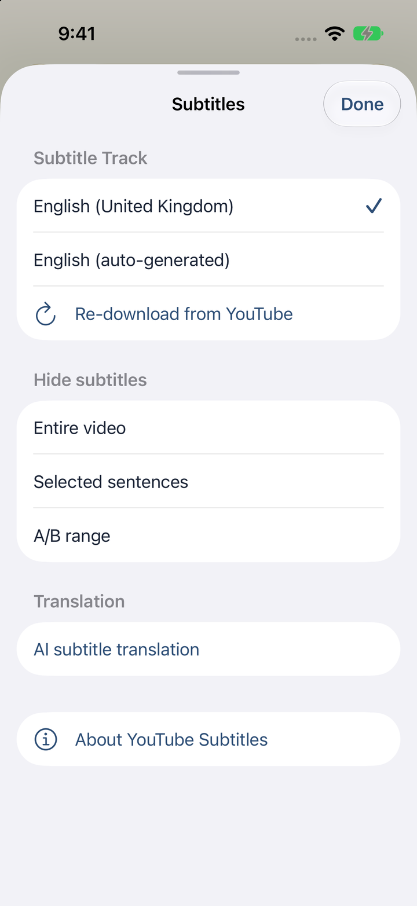

### 10-3. Full-screen Practice
上部の拡大ボタンで**Full-screen Practice**を開くと、A/Bツールと一緒に大きく表示できます。カードボタンで映像の横に文パネルが開きます。カードで文を反復し、パネルの目・翻訳ボタンは通常画面の表示状態を共有します。翻訳の開始、隠す範囲の選択、カード編集は通常画面で行います。

Phrabbitの全画面ツールは**Hide / Show**で折りたたみ・表示を切り替えます。YouTube映像へのタップはYouTubeが処理します。内向きの斜め矢印の**Exit full screen**ボタンは常に残り、タップすると再生を続けたまま通常のプレーヤーへ戻ります。iPhoneではアプリ内の表示を回転するため、端末の回転ロックを解除する必要はありません。

### 10-4. 時間ルーラー
Stream ではオーディオ波形の代わりに時間ルーラーを使います。

- **ドラッグ** - 動画位置を移動
- **長押し** - A/B ポイントを設定
- **ピンチ** - ルーラーを拡大/縮小
- **A/B ハンドル調整** - 区間を微調整

YouTube の埋め込みプレーヤーは実際の音声サンプルをアプリに提供しないため、偽の波形ではなく時間ルーラーを使います。

### 10-5. YouTube のバックグラウンド動作
YouTube ストリームはロック画面やバックグラウンドで再生を続けられません。アプリがバックグラウンドへ移動すると動画を停止し、位置を記憶して、アプリに戻ったときにその位置を復元します。これは YouTube 埋め込みプレーヤーと iOS WebKit の制限です。

## 11. 動画ファイルの練習

端末や iCloud Drive にある動画ファイルも学習素材として使えます。動画でも音声と同じ A/B 区間リピート、シャドーイング、ディクテーション、ブックマークをそのまま利用でき、字幕は別途用意した字幕ファイルを読み込んで使います。

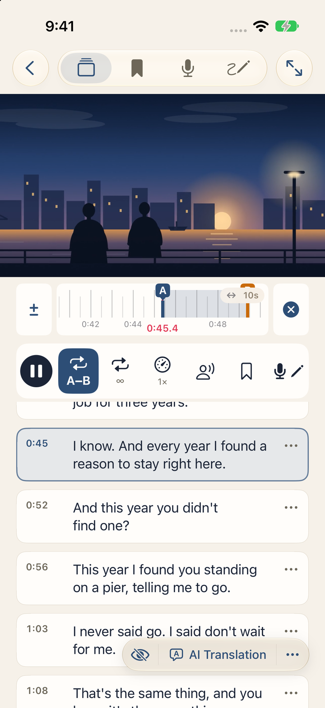
*▲ 字幕、A/B 付きの時間ルーラー、保存したブックマークをまとめて表示する動画プレーヤー*

### 11-1. 動画ファイルを追加する
ホーム画面のプラスメニューで **Add Video File** をタップし、動画を選びます。無料で使える機能です。

対応形式は **MP4、M4V、MOV** です。MKV、AVI、WebM などの形式はファイル選択画面で選べません。

対応形式であっても、ファイル内の映像や音声がこの端末で再生できない方式でエンコードされていることがあります。その場合はどのエンコード方式かがメッセージに表示されます。H.264 または HEVC 映像 + AAC 音声に変換すると再生できます。

一つ紛らわしいケースがあります。コーデックはすでに HEVC なのに、`hvc1` ではなく `hev1` 形式でパッケージされたファイルです。iOS は `hev1` のパッケージを再生できません。この場合は `hvc1` に再パッケージ（リマックス）するだけで済み、映像を再エンコードする必要はありません。

### 11-2. 動画はコピーせず元ファイルを参照します
音声ファイルはアプリ内にコピーされますが、動画ファイルは元の場所に置かれたままです。Phrabbit は元ファイルへのリンクだけを記憶します。

実際の使用で変わる点は次のとおりです。

- 動画を追加しても、ファイルサイズにかかわらずアプリの容量をほとんど使いません。
- 元ファイルを移動、名前変更、削除すると再生できなくなります。iCloud Drive のファイルがそのアカウントから削除された場合や、端末から取り除かれた場合も同様です。
- ファイルが見つからないとき、ライブラリ一覧には **File missing** の警告が表示され、項目を開くと **Re-link File** と **Remove** がある画面が表示されます。**Re-link File** で新しい場所のファイルを選び直せば、ブックマーク、字幕、再生位置はそのままで練習を続けられます。
- 再リンクしたファイルの長さが元の動画と大きく異なる場合は、**Different video length** の案内が表示されます。リピート区間と字幕の位置がずれる可能性があるためです。

iCloud Drive にあり、まだ端末にダウンロードされていない動画を初めて再生すると、**Preparing video…** の表示とともにシステムがファイルをダウンロードします。長い動画では時間がかかることがあります。一度ダウンロードされれば、ファイルがどれだけ大きくてもすぐに開きます。

### 11-3. 動画プレーヤー
通常の動画画面もStreamと同じ4タブと7つのツールを使います。**Subtitles / Bookmarks / My Recordings / Dictation**を切り替え、時間ルーラーとA/Bツールはリストの上に固定されます。

- 映像のタップで再生／一時停止。シークバーは映像下端に重なり、再生中は消えます。映像のタップや再生操作で再表示されます。
- ルーラー横の**±**で微調整、**×**で区間解除。**Practice**はツール列にあります。
- 字幕はツール下の文カードで表示。カードを読みながらA/Bを調整できます。
- 字幕がなければSubtitlesタブで**Import subtitle file…**または区間音声認識を選びます。全画面は上部の拡大ボタンです。
- 幅の広いiPad横向きウインドウでは、画面全幅の上部バーにサムネイル・タイトル・全画面ボタンが表示されます。左に映像とツール、右パネルの最上部にタブ、その下にリストが並びます。縦向きや狭いウインドウは1列です。

動画には波形がありません。無料では動画ごとに1件のブックマークを新規保存でき、Premium・体験中は無制限です。保存済みブックマークは引き続き開けます。

### 11-4. 字幕ファイルを使う
別途用意した**SRT、VTT、SMI（SAMI）**ファイルを読み込みます。動画内蔵の字幕トラックには対応しません。字幕がなければSubtitlesタブの**Import subtitle file…**、ある場合は右下の**··· > Replace subtitle file…**を使います。

添付プレビューで字幕言語と文を保存前に確認できます。対応する二言語字幕では**原文字幕**と**ファイル翻訳**のトラックを選択・交換し、翻訳なしや分割しない取り込みもできます。SMIの言語トラックと、SRT/VTTで別々の行にある英語・韓国語を分離できます。同じ行に混在した文は自動分割しません。**Change**で単語帳・発音・AI翻訳に使う言語を修正します。確定時に適用され、キャンセルで既存字幕が保たれます。

ファイル翻訳の表示にはApple IntelligenceやPremiumは不要です。**··· > Translation**で原文のみ・原文＋翻訳・翻訳のみを選びます。利用可能なら**Translation source**で**File subtitles / AI Translation**を切り替えられます。AI翻訳を削除してもファイル翻訳は残ります。AI翻訳には対応端末とPremiumの条件が適用されます。

同じ設定シートに区間字幕生成、**Subtitle Sync…**（0.5秒単位）、復元可能な場合の**Restore Original Subtitles…**、隠す範囲、**Delete Subtitles**があります。文の編集と単語帳追加はカードの**⋯**から行います。通常画面はカード表示で、全画面ではカードパネルを閉じると映像上の字幕も表示できます。

UTF-8を推奨します。BOM付きUTF-16と一般的な従来のSMI文字コードも対応します。読めない場合はUTF-8で保存し直してください。

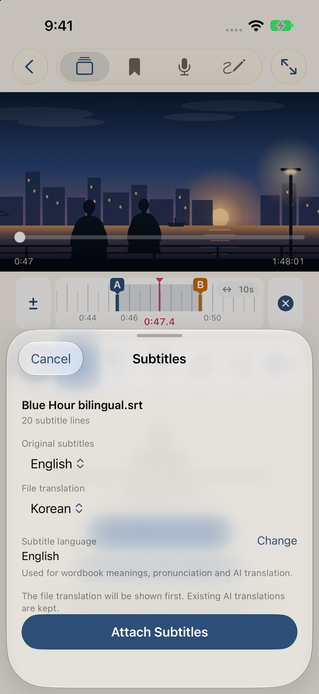

※ この例では、英語の原文と韓国語の翻訳を使用しています。両方とも字幕ファイルに含まれる内容で、AIが生成した翻訳ではありません。表示される言語は、読み込む字幕ファイルによって変わります。

動画の字幕設定

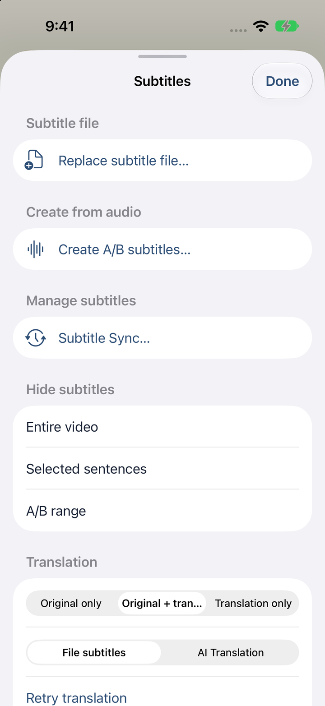

### 11-5. 文単位で練習する
文カードは同じ文に属する字幕行をまとめます。押すとその文がA/Bになり反復し、次のカードへは自動で進みません。字幕同期の調整もカードに反映されます。

*▲ 文カードと固定された練習ツールを一緒に使う画面*

現在の文が強調されます。別の文をスクロールして見た後は**Current Subtitle（◎）**で戻れます。右下の目ボタンは時間と反復を保ったまま文字を隠します。**···**で動画全体・選択した文・A/B区間を選びます。翻訳ボタンは原文のみと原文＋翻訳を切り替え、翻訳のみは設定で選択します。

スクロールを終えた後、再生が画面内のカードに到達すると追従が再開します。◎ですぐに現在の文へ戻ることもできます。

### 11-6. シーンの文字起こし
動画ではファイル全体の音声テキスト変換は行いません。代わりに、いま練習している区間だけを文字起こしできます。プレミアムまたは無料トライアル中に利用できます。

1. 文字起こししたい部分に A/B 区間を設定します。
2. Subtitlesタブの**···**から区間字幕生成を選びます。字幕がなければ空のタブの区間音声認識ボタンを使います。
3. そのシーンで話されている言語を選びます。

注意点:

- 区間が **10 分**を超えると文字起こしできません。先に A/B 区間を短くしてください。
- 区間が 3 分を超える場合や端末がすでに温かい場合は、先に **Transcribe This Scene?** の案内が表示されます。**Continue** をタップすると続行します。端末がかなり熱い場合は、冷めてから試すよう案内されるだけで実行されません。
- その区間に字幕ファイルの字幕がすでにある場合は、**Replace Subtitles in Range?** の確認が先に表示されます。区間内の字幕だけが置き換えられ、元の字幕は保管されるため、**Restore Original Subtitles…** で戻せます。

### 11-7. 全画面とバックグラウンド
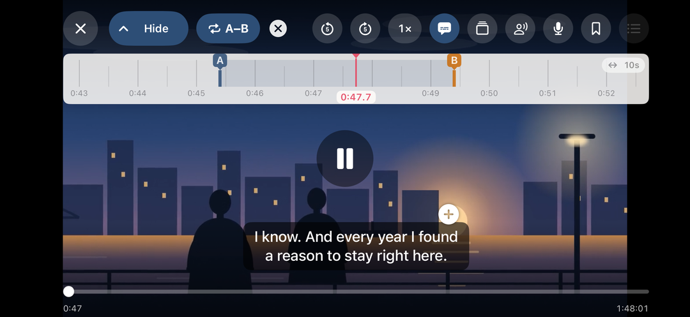
*▲ 全画面でも A/B コントロールと字幕を表示したまま練習できます*

全画面ボタンをタップすると映像が大きく表示されます。アプリ自体は縦画面のまま横向きに画面いっぱいへ広げるため、端末の画面回転ロックを解除する必要はありません。全画面では映像をタップしてコントロールの表示/非表示を切り替えられ、ブックマーク一覧で保存した区間の間を移動できます。

内向きの斜め矢印（**Exit full screen**）で通常のプレーヤーへ戻れます。他の全画面ツールを隠してもこのボタンは表示され、全画面を終了しても再生は続きます。

全画面でも、カードボタンで同じ文の一覧を映像の横に表示できます。一覧が映像を覆うことはなく、映像とルーラー、シークバーが横にずれて場所を空け、パネルを閉じると元の幅に戻ります。

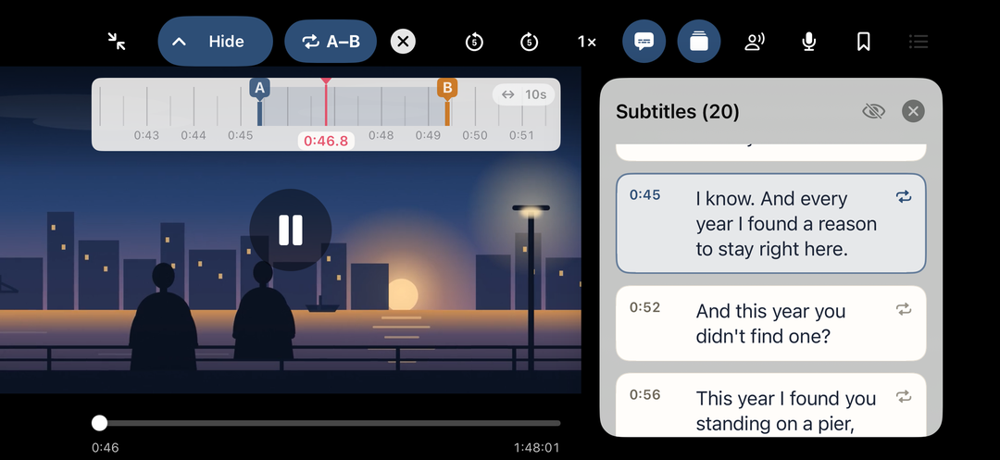
*▲ 全画面では、カードが映像を覆わずに横へ並びます*

動画はバックグラウンドやロック画面では再生されません。アプリがバックグラウンドに移るか画面がロックされると再生は停止します。バックグラウンド再生は音声ファイルにのみ適用されます。

### 11-8. 名前の変更、情報と削除
動画のタイトルは、最初はファイル名で表示されます。ライブラリ行末の **⋯** をタップするか行を長押しして **Rename** を選ぶと変更できます。**Info** では完全なタイトル、項目の種類、長さ、追加日、フォルダの場所を確認できます。

同じメニューから **Delete** を選ぶと、Phrabbit 側の項目情報と字幕、ブックマーク、保存済みシャドーイング録音、ディクテーション履歴が整理されます。**元の動画ファイルは削除されません。** 保存済み録音がある場合は、削除前に確認画面が表示されます。

## 12. シャドーイング録音と比較

シャドーイングは、A/B 区間を聞き、自分で発話し、自分の録音を元音声と比較する機能です。

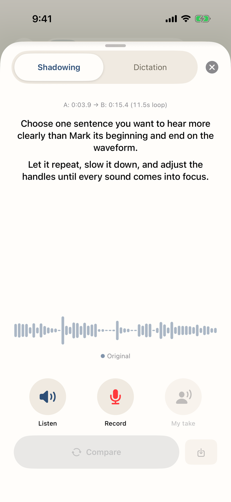
*▲ A/B 区間を聞いて録音し、元音声と比較するシャドーイング画面*

### 12-1. シャドーイング間隔
録音なしでも使える練習方法です。

1. A/B 区間を設定します。
2. シャドーイング間隔ボタンをオンにします。
3. 区間が再生されたあと無音時間が入ったら、自分で真似して話します。
4. カウントダウンが終わると、再び元音声が再生されます。

この機能はオーディオ、動画、YouTube ストリームのいずれでも使えます。

### 12-2. 録音と比較
録音/比較はプレミアム機能です。

1. A/B 区間を設定します。
2. 固定ツール列の**Practice**を押します。
3. 上部で **Shadowing** を選び、**Listen** で元の区間を聞きます。
4. **Record** を押して自分の声を録音します。
5. **My take** で自分の録音だけを聞きます。
6. **Compare** で元音声と自分の録音を続けて比較します。

初回利用時はマイク権限を求められます。録音は端末内に保存されます。

オーディオファイルでは、元音声の波形と自分の録音波形を一緒に確認できます。動画と YouTube ストリームでは元波形を取得できないため、自分の録音波形のみ表示されます。

### 12-3. 字幕と一緒に練習
選択したA/Bと重なる字幕カードがあれば、その文が練習画面に渡されます。読み込み済みのYouTube字幕やローカル動画字幕も使えます。シャドーイングは聞きながら参考文を表示し、ディクテーションは答え合わせまで隠します。字幕がなくても聞く・録音する操作は利用できます。

### 12-4. 自分の録音を保存して開く
気に入ったテイクは保存ボタンで保存します。元の素材の**My Recordings**タブから開け、同じA/B区間のテイクは1つのグループにまとまります。

保存した録音をタップすると、その録音を作成した A/B 区間へ戻り、シャドーイング画面が再び開きます。同じ区間の複数テイクは、1 つの練習ポイントとしてまとめて表示されます。

保存済み録音やブックマークを管理するには、行またはカード末尾の **⋯** をタップするか長押しします。どちらも同じメニューを開き、スワイプでは削除されません。**Info** を選ぶと、ブックマークでは範囲、長さ、保存日を、録音では範囲、長さ、テイク数、録音日を確認できます。

## 13. ディクテーション

ディクテーションは、A/B 区間を 1 問ずつ聞いて書き取り、原文と比較するプレミアム練習機能です。音声、動画、YouTube で利用でき、無料トライアル中も使えます。

### 13-1. ディクテーションを始める
1. 練習する A/B 区間を設定します。
2. 固定ツール列の**Practice**を押します。
3. 上部で **Dictation** を選びます。最後に使った練習モードは、次に開いたときも記憶されています。

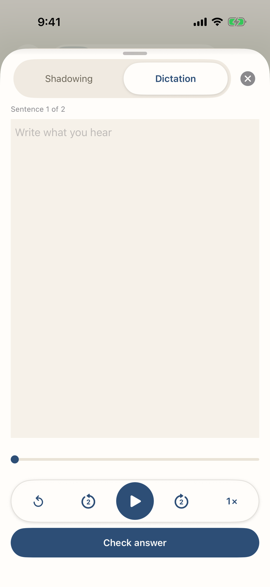
*▲ 上部に Shadowing / Dictation の切り替えがある練習シート。Dictation を選択した状態*

読み込んだ字幕があれば正解の基準に使います。音声では文ごとの練習ができ、動画とYouTubeは選択したA/B区間の字幕を参考にします。字幕がなければ正解を手入力するか映像で確認します。ディクテーションは全画面ではなく通常プレーヤーから開始します。

### 13-2. 聞いて書く
**Listen** で現在の文を一度聞き、聞こえた内容をキーボードで入力します。再生／一時停止、2 秒戻る／進む、再生速度を利用できます。速度ボタンをタップすると、0.5× から 2× までの 6 段階が一度に表示されます。書き終えたら **Check answer** をタップします。

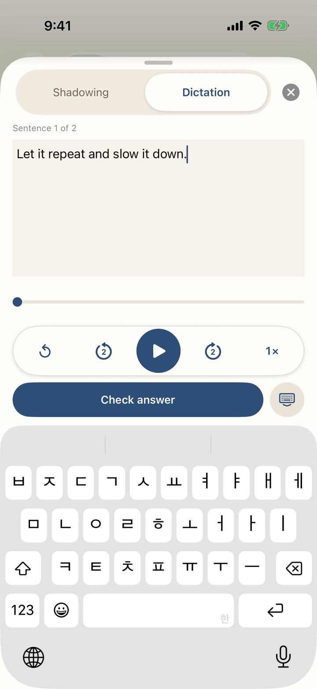
*▲ キーボードの上に再生コントロール、速度、Check answer が並ぶ入力画面*

横幅の広い iPad 画面では **Keyboard** と **Handwriting** を切り替えられます。手書き画面にはペンの色、蛍光ペン、消しゴム、取り消し、すべて消す、指で書く設定があります。筆跡はそのまま保存されますが、Phrabbit は手書きを読み取ったり自動採点したりしないため、原文と自分で比較してください。入力方法の選択は次回も維持されます。Split View や Stage Manager でウインドウが狭い場合は、キーボード入力のみ表示されます。

*▲ 幅の広い iPad ウィンドウの手書きページ: 紙の上にペンの色、蛍光ペン、消しゴム、取り消し、すべて消去、左下にキーボード / Handwriting の切り替え*

### 13-3. 答え合わせと採点
字幕または自分で保存した正解がある場合は、書いた内容と原文を自動比較し、違う箇所を示します。新しく音声認識した音声で A/B 区間が文の途中を切っている場合は、単語タイミングを使って実際に聞こえた部分だけを比較します。正確な単語タイミングがない途中で切れた文では、自動比較が行われない場合があります。その場合は **Whole sentence** で文全体を練習すると自動比較を再び使え、**My range** で元の区間に戻れます。

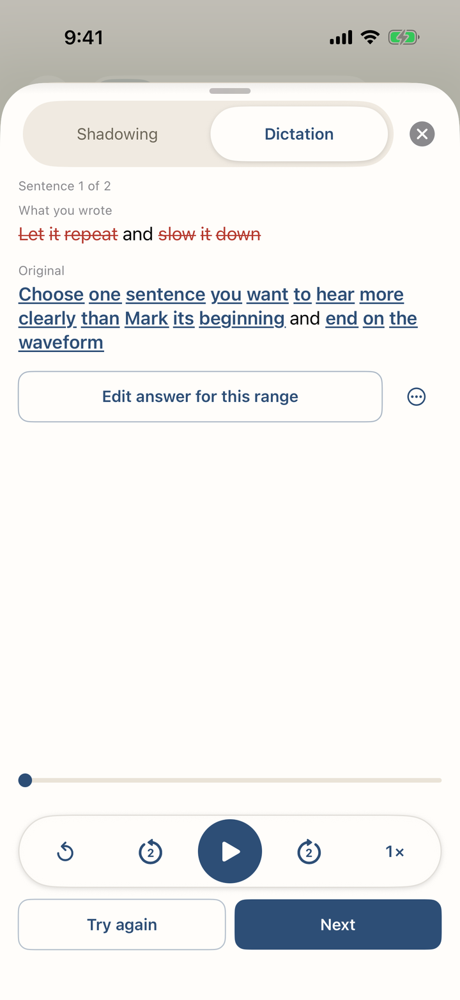
*▲ 元の文との違いが表示された比較結果と Try again、Next*

字幕がなければ映像で確認するか、発話を入力してそのA/B区間の正解に保存します。**この区間の正解を修正**は個人の正解だけを変更し、字幕と以前の入力は保ちます。現在の字幕に戻すことや、字幕がない場合に入力した正解を削除することもできます。別の**字幕を修正**は字幕自体を変更します。**Restore original text**は編集欄に原文を戻す操作で、保存して確定します。音声認識やYouTube自動生成字幕には誤りがあるため、比較基準を確認してください。

iPhone または幅の狭い iPad ウインドウで **Check in the video** をタップすると、ディクテーションシートが下がり、動画と YouTube のコントロールを直接操作できます。幅の広い iPad では専用の練習ワークスペースが開き、書いている間は動画が隠れ、答え合わせのときに比較内容の上へ戻ります。

確認後、**Try again** を選ぶと同じ問題がセッションの最後にもう一度出され、**Next** で次へ進みます。最後の問題では **Finish** が表示されます。

### 13-4. 履歴を見てもう一度練習
1文でも入力または確認したセッションは閉じると自動保存されます。元の素材の**Dictation**タブでA/B区間ごとの試行を確認できます。

履歴を開くと、入力内容、原文、自動比較結果、保存した手書きを確認できます。同じ区間を複数回練習した場合は **Attempt** チップで過去の試行を切り替えられます。**Practice again** で同じ区間を再開したり、不要な試行を削除したりできます。保存済み履歴はプレミアム終了後も閲覧できますが、新しいディクテーションにはプレミアムまたは無料トライアルが必要です。

*▲ 保存された履歴: Attempt の切り替え、書いた内容、元の文、Practice again*

ディクテーション画面で聞いたり書いたりした時間は学習記録に含まれます。ほかのアプリへ移動すると計測は止まり、操作しないまま長時間置くと自動的に一時停止します。

## 14. ポッドキャスト

ポッドキャストのダウンロードはプレミアム機能です。番組名で検索したり、練習言語別のおすすめを見たり、Apple Podcasts の購読一覧または RSS アドレスからエピソードを読み込み、オーディオプレーヤーで練習できます。

### 14-1. 練習言語別に探す
ホーム画面のプラスメニューで **Add from Podcast** をタップします。初回は練習したい言語を選びます。韓国語、英語、日本語、中国語、スペイン語、フランス語には Phrabbit が選んだ番組リストがあり、そのほかの練習言語も選べます。

言語を選ぶと、**Browse in …** の下にトピックチップと番組リストが表示されます。最初は学習者向け番組と最新ニュースなどが選択されています。チップをオン／オフすると、初級、ゆっくりした会話、歴史、旅行、音楽などのリストを追加または非表示にできます。各言語では、役立つ検索結果があるトピックだけが表示されます。**Change language** でいつでも言語を変更できます。

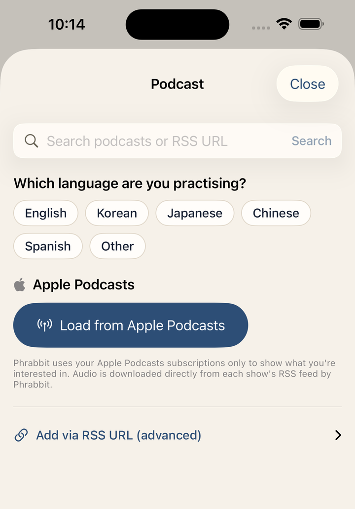
*▲ 初回はまず練習する言語を選びます*

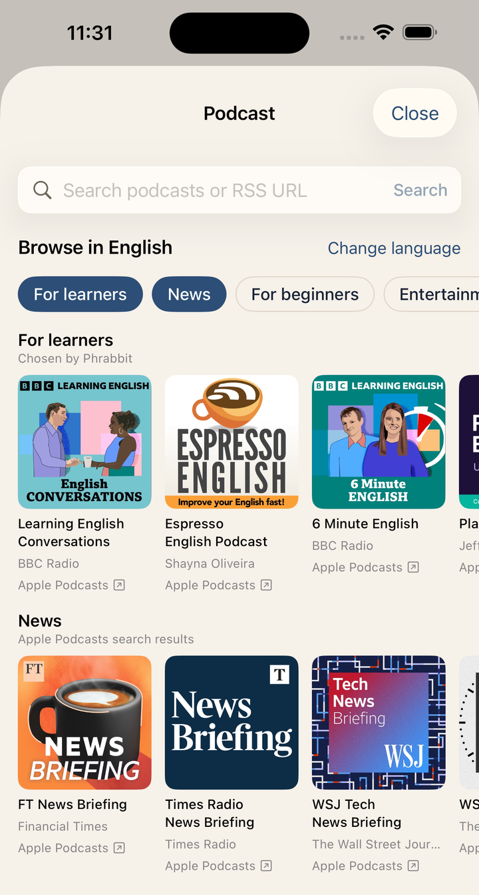
*▲ トピックチップで絞り込み、各列は横にスクロールします*

**Chosen by Phrabbit** はアプリが選んだリスト、**Apple Podcasts search results** は Apple の検索結果です。「英語で解説」などのバッジは、練習言語とは別の言語で説明する番組であることを示します。

### 14-2. 番組名または RSS URL で検索
画面上部の **Search podcasts or RSS URL** に番組名を入力して検索します。番組カードをタップすると、どの入口からでも同じエピソード一覧が開きます。この欄に RSS URL をそのまま貼り付けてフィードを開くこともできます。

### 14-3. Apple Podcasts の購読一覧
初回利用時はメディアライブラリ権限を求められる場合があります。**Load from Apple Podcasts** をタップして許可すると、購読中の番組が **My podcasts** に表示されます。この権限は関心のある番組を表示するためだけに使われ、エピソード音声は Phrabbit が各番組の RSS フィードから直接ダウンロードします。

チャンネルをタップするとエピソード一覧が開きます。

### 14-4. エピソードのバッジ

| バッジ | 意味 |
|---|---|
| **Creator captions** | 時間情報付きの公式字幕あり |
| **Creator transcript** | テキストのみの公式資料あり |
| バッジなし | 公式字幕なし |

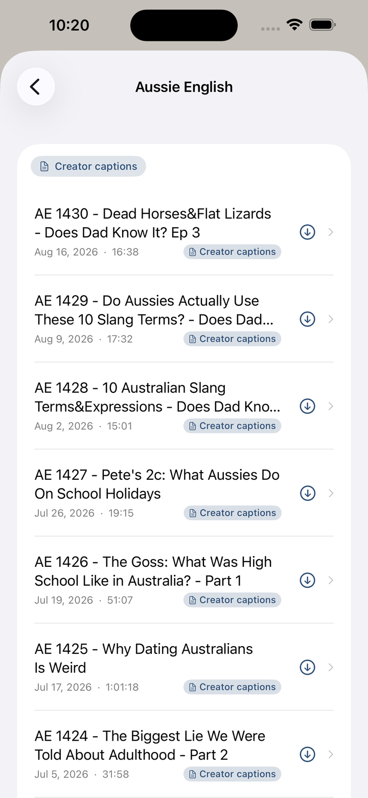
*▲ Creator captions バッジ付きエピソードは公式字幕も一緒に読み込めます*

**Creator captions** バッジ付きエピソードでは、アプリが STT を新たに実行せず、ポッドキャストが提供する公式字幕を読み込めます。通常は自動認識より正確で、待ち時間も少ないため、学習素材を選ぶときはまずこれらのエピソードをおすすめします。

### 14-5. RSS アドレスを直接入力
検索欄に RSS URL を貼り付けるほか、**Add via RSS URL (advanced)** を展開して直接入力できます。Apple Podcasts 検索に出ないポッドキャストや、RSS アドレスをすでに知っている場合に使います。

### 14-6. ダウンロードとセルラー通信
初期設定は **Download over Wi-Fi only** です。セルラーダウンロードを許可している場合、大きなエピソードを受け取る前に確認画面が表示されることがあります。

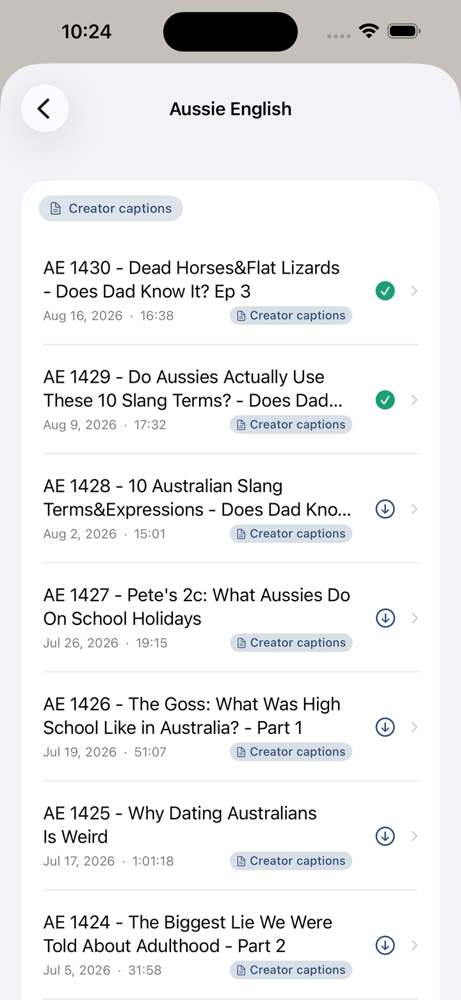
*▲ ダウンロード前とダウンロード済みの状態をエピソード一覧で確認できます*

エピソードをタップするとダウンロードが始まります。ダウンロード中は、進行リング内の停止ボタンをタップするとキャンセルできます。Wi-Fi 待ちの時計が表示されている場合は、エピソードをもう一度タップすると待機列から外せます。チェックマークが付いたエピソードをタップするとプレーヤーが開きます。

一部のポッドキャストファイルは、初回再生時にアプリが再生可能な形式へ準備するため、少し時間がかかることがあります。公式字幕または STT 字幕があるエピソードは、対応端末で [8-3. 字幕全体を翻訳](#8-3-字幕全体を翻訳) を利用できます。

## 15. 学習記録と設定

### 15-1. 学習記録タブ
**学習記録（Progress）** タブでは、最近の学習量を確認できます。

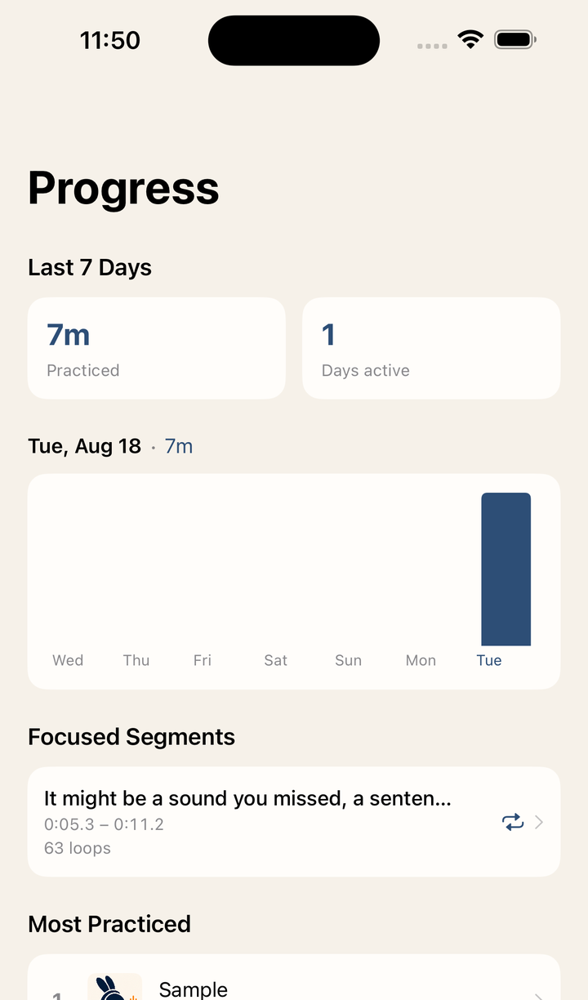
*▲ よく繰り返した区間と直近 7 日間の学習量を確認する画面*

主な項目:

- **Last 7 Days** - 直近 7 日間の練習時間と活動日数
- 棒グラフ - 日付ごとの練習時間
- **Focused Segments** - 最近繰り返して練習した区間
- **Most Practiced** - よく練習した音声、動画、YouTube 項目
- **All Time** - 全期間の累計練習時間

Focused Segments や Most Practiced の項目をタップすると、元の素材へ戻って再び練習できます。シャドーイングとディクテーションで実際に練習した時間も合算されます。統計はこの機能が追加された後の練習から記録されます。

### 15-2. 設定画面
ホーム画面右上の **その他** をタップし、**Settings** を選ぶと設定が開きます。

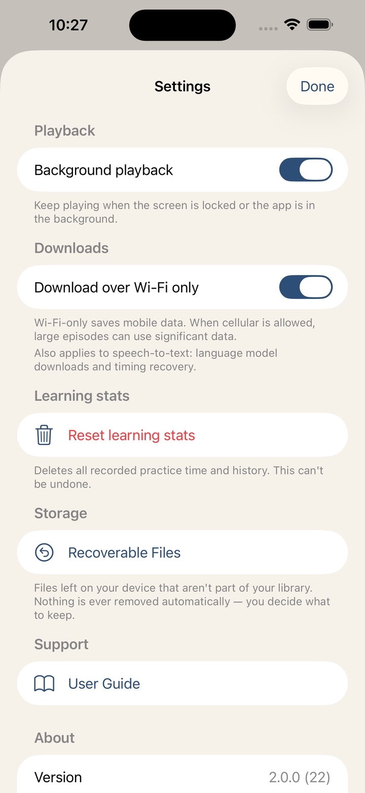
*▲ バックグラウンド再生、ダウンロード、学習記録削除、Support 項目をまとめた設定画面*

設定でできること:

- **Background playback** - プレミアムユーザー向けのロック画面/バックグラウンド音声再生設定
- **Download over Wi-Fi only** - ポッドキャストダウンロード、STT モデルダウンロード、時間情報復旧に Wi-Fi 優先を適用
- **Ask before cellular download** - セルラーダウンロード前に確認
- **Reset learning stats** - 学習記録を削除
- **Rate Phrabbit** - App Store レビュー画面を開く

学習記録の削除は元に戻せないため注意してください。

## 16. 無料版とプレミアム

### 無料で使える機能

- ローカル音声ファイルの読み込み
- ミュージックライブラリの DRM なし曲の読み込み
- YouTube リンク追加と A/B リピート練習
- 動画ファイル追加と A/B リピート練習
- 動画の字幕ファイル（SRT、VTT、SMI）読み込み
- 波形表示、時間ルーラー、A/B 区間リピート
- リピート回数と再生速度の調整
- シャドーイング間隔
- スリープタイマー
- オーディオブックマークをファイルごとに新規 1 件作成
- 動画ブックマークを動画ごとに新規 1 件作成
- プレミアムまたは無料トライアル期間中に保存した既存オーディオブックマークを開く
- 字幕のある音声・ローカル動画・YouTubeのカードを隠す操作、音声の文の時刻編集
- 二言語の動画字幕から取り込んだファイル翻訳の表示
- 学習記録

### プレミアムまたは無料トライアル中に使える機能

- 字幕のあるYouTube動画のカード練習（新しい字幕の取得・トラック変更）
- 音声テキスト変換（STT）字幕
- 字幕と波形のリアルタイム連動
- 単語帳
- Apple Intelligence 説明生成（対応端末）
- オーディオブックマーク無制限
- 動画ブックマーク無制限
- 動画のシーン文字起こし
- YouTube ストリームブックマーク
- ポッドキャストダウンロード
- シャドーイング録音、比較、保存
- ディクテーション、自動比較、履歴保存、iPad の手書き
- Apple Intelligence による字幕全体の翻訳（対応端末）
- オーディオのバックグラウンド再生とロック画面操作

### 支払い方式
Phrabbit Premium は **一回限りの購入** です。サブスクリプションではなく、一度購入すれば同じ Apple ID で継続して利用できます。端末を変更した場合は、プレミアム画面の **Restore Purchase** で購入を復元してください。

## 17. よくある質問

**Q. Apple Music サブスクリプションで聴いている曲を読み込めますか？**

A. Apple Music サブスクリプションでダウンロードした曲には DRM 保護がかかっているため、他のアプリでは使用できません。iTunes Store で直接購入した曲、または CD から変換した DRM なしの曲のみ読み込めます。

**Q. 音声認識結果が不正確です。**

A. まず、音声の実際の言語と選択した STT 言語が同じか確認してください。背景音楽、雑音、複数人が同時に話す区間は認識が難しい場合があります。必要な部分は字幕編集や Add Segment で直接修正するのが最も確実です。

**Q. STT 変換中にアプリを離れても続きますか？**

A. いいえ。現在の STT 変換はアプリを開いた状態で進める必要があります。画面をロックしたり他のアプリへ移動したりすると、変換が中断されることがあります。オーディオのバックグラウンド再生と STT 変換は別の機能です。

**Q. ディクテーションで自動比較が表示されません。**

A. 自動比較には利用できる字幕か保存した正解が必要です。読み込み済みYouTubeカードも基準にできます。正確な時刻情報なしで文を途中で切る区間は手動確認になる場合があります。表示される場合は**Whole sentence**を使うか、区間の正解を保存してください。手書きは筆跡として保存され、手動で比較します。

**Q. 音声はロック画面でも再生され続けますか？**

A. Premiumまたは無料体験と**Background playback**設定が必要です。ロック画面・コントロールセンター・対応イヤホンで再生／一時停止と前／次を使えます。前／次は文を移動し、Play All中はブックマークを移動します。字幕がなければ5秒移動に切り替わります。設定をオフにするか体験が終わると、バックグラウンド移行時に停止します。

**Q. 動画を追加するとアプリの容量を使いますか？**

A. ほとんど使いません。動画ファイルはアプリ内にコピーされず、Phrabbit は元ファイルへのリンクだけを保存します。その代わり、元のファイルを移動、名前変更、削除した場合や、iCloud Drive から端末にダウンロードされていない状態になった場合は再生できなくなります。そのときは **Re-link File** でファイルを再度リンクしてください。

**Q. 動画に「File missing」と表示されます。**

A. 元のファイルが移動、名前変更、削除されたか、この端末にダウンロードされていない状態です。その動画を開いて **Re-link File** をタップし、新しい場所のファイルを選んでください。ブックマーク、字幕、再生位置はそのまま保持されます。ファイルを完全に削除した場合は **Remove** で項目を整理できます。

**Q. MP4 ファイルなのに再生できません。**

A. 形式（コンテナ）には対応していますが、その中の映像や音声がこの端末で再生できない方式でエンコードされている場合です。H.264 または HEVC 映像 + AAC 音声に変換すると再生できます。メッセージに `hev1` と出る場合は、コーデック自体は HEVC ですが iOS が再生できない形式でパッケージされている状態で、`hvc1` に再パッケージ（リマックス）するだけで解決します。映像を再エンコードする必要はありません。

**Q. 動画もバックグラウンドで再生されますか？**

A. いいえ。アプリがバックグラウンドに移るか画面がロックされると、動画の再生は停止します。バックグラウンド再生は音声ファイルにのみ適用されます。

**Q. YouTube もバックグラウンドで再生され続けますか？**

A. いいえ。YouTube ストリームはバックグラウンド再生に対応していません。アプリはバックグラウンドに入ると動画を停止し、位置を記憶して、戻ってきたときにその位置を復元します。

**Q. YouTube 動画がアプリ内で再生されません。**

A. 一部の動画は所有者が YouTube 外部での再生を許可していないため、埋め込みプレーヤーで再生できない場合があります。その場合、Phrabbit 内では使用できません。

**Q. データはインターネットへ送信されますか？**

A. 単語帳、ブックマーク、字幕、録音は端末内に保存されます。STT は可能な場合、端末内モデルを使用します。ただし言語、iOS バージョン、モデルのインストール状態によっては、Apple の音声認識サービスやモデルダウンロードが必要になる場合があります。**Download over Wi-Fi only** 設定はモデルダウンロードや一部のネットワークベース復旧にも適用されます。YouTube 動画は YouTube 埋め込みプレーヤーで再生されます。

**Q. Apple Intelligence の説明は常に正確ですか？**

A. いいえ。ベータ機能であり、誤ることがあります。単語帳に保存する前に、意味、例文、説明を自分で確認し、必要な部分を修正してください。

**Q. AI Explanation が表示されません。**

A. この機能には iOS 26 以降、Apple Intelligence 対応端末、Apple Intelligence の有効化とモデル準備、対応している学習言語と端末言語が必要です。学習言語を判定できない場合や、その言語がモデルでサポートされていない場合、セクションは表示されないことがあります。同じ言語では iOS 翻訳機能が別の翻訳を作れないこともあるため、必要に応じて手動で入力してください。

**Q. 保存した録音はどこにありますか？**

A. 元の素材を開き、**My Recordings**タブを選びます。ディクテーションの記録は**Dictation**です。元の項目を削除すると関連する練習記録も削除されます。動画項目を消しても元の動画ファイルは残ります。

**Q. 端末を変えると学習データも移動しますか？**

A. 現在、アプリの学習データは基本的に端末内に保存されます。同じ Apple ID で **Restore Purchase** を行うとプレミアム購入は復元されますが、単語帳、ブックマーク、字幕、録音などの学習データが自動的に別端末へ移動するわけではありません。

ご質問や不具合は **phrabbit.support@gmail.com** までご連絡ください。アプリにエラーコードが表示された場合は、あわせてお知らせいただくと原因の特定が早くなります。
