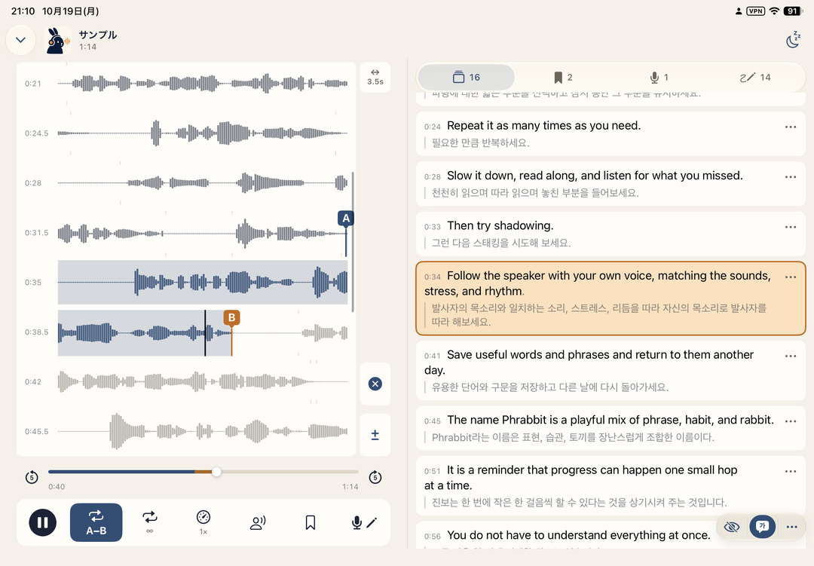
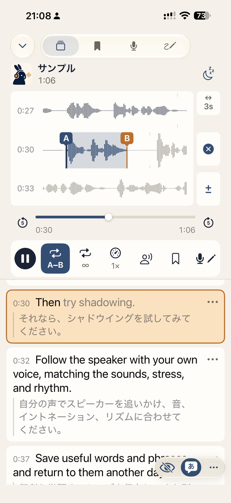
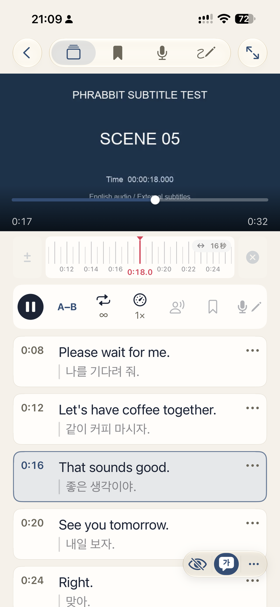

Phrabbit은 외국어 듣기 연습을 위한 A/B 구간 반복 앱입니다. 오디오 파일, 동영상 파일, 뮤직 라이브러리, 팟캐스트, YouTube 링크를 학습 자료로 추가하고, 원하는 구간을 반복해서 듣거나 따라 말하고 받아쓰며 연습할 수 있습니다. 자막 변환, 단어장, 쉐도잉 녹음, 받아쓰기 기록, 학습 기록도 함께 사용할 수 있습니다.

> 참고: 이 설명서의 버튼 이름은 앱 화면에 보이는 영문 UI를 기준으로 적었습니다. 기기 언어에 따라 일부 문구는 한국어로 표시될 수 있습니다.

이 매뉴얼은 **Phrabbit 4.0.0** 기준입니다. 플레이어 배치는 iPhone·iPad의 사용 가능한 창 너비에 맞춰 달라집니다.

## 목차

1. [시작하기](#1-시작하기)
2. [홈 화면과 라이브러리](#2-홈-화면과-라이브러리)
3. [학습 자료 추가하기](#3-학습-자료-추가하기)
4. [오디오 플레이어](#4-오디오-플레이어)
5. [A/B 구간 반복](#5-ab-구간-반복)
6. [북마크와 반복 목록](#6-북마크와-반복-목록)
7. [음성-텍스트(STT) 자막](#7-음성-텍스트stt-자막)
8. [자막 편집, 번역, 직접 추가](#8-자막-편집-번역-직접-추가)
9. [단어장](#9-단어장)
10. [YouTube 스트림 연습](#10-youtube-스트림-연습)
11. [동영상 파일 연습](#11-동영상-파일-연습)
12. [쉐도잉 녹음과 비교](#12-쉐도잉-녹음과-비교)
13. [받아쓰기](#13-받아쓰기)
14. [팟캐스트](#14-팟캐스트)
15. [학습 기록과 설정](#15-학습-기록과-설정)
16. [무료 vs 프리미엄](#16-무료-vs-프리미엄)
17. [자주 묻는 질문](#17-자주-묻는-질문)

## 1. 시작하기

### 1-1. 첫 실행 - 온보딩
앱을 처음 실행하면 Phrabbit의 기본 흐름을 보여주는 안내 화면이 나옵니다.

1. **파형과 A/B 구간 반복** - 소리를 눈으로 보면서 시작점 A와 끝점 B를 잡고 반복합니다.
2. **자막, 단어장, 복습 흐름** - 자막을 보고 모르는 단어를 저장하며 학습 기록을 쌓습니다.

마지막 화면에서는 두 가지 중 하나를 선택할 수 있습니다.

| 버튼 | 설명 |
|---|---|
| **Try with a sample** | 샘플 오디오를 열고 플레이어 튜토리얼을 따라 해봅니다 |
| **Skip** | 바로 홈 화면으로 이동합니다 |

### 1-2. 무료 체험
온보딩을 마치면 **3일 무료 체험**이 시작됩니다. 체험 기간에는 프리미엄 기능까지 자유롭게 써볼 수 있습니다. 체험 중에는 플레이어 위쪽에 **Trial** 배너가 표시되고, 배너를 눌러 바로 프리미엄 구매 화면을 열 수 있습니다.

## 2. 홈 화면과 라이브러리

홈 화면은 추가한 학습 자료가 모이는 곳입니다. 로컬 오디오, 동영상 파일, 뮤직 라이브러리 곡, 팟캐스트 에피소드, YouTube 링크가 같은 라이브러리 목록에 함께 표시됩니다.

*▲ 파일, 팟캐스트, YouTube를 함께 보여주는 홈 화면*

### 2-1. 화면 구성

| 위치 | 요소 | 설명 |
|---|---|---|
| 상단 | Phrabbit 워드마크 | 목록을 아래로 스크롤하면 작은 제목으로 전환 |
| 오른쪽 위 | 플러스 버튼 | 학습 자료 추가 메뉴 |
| 오른쪽 위 | 검색 버튼 | 라이브러리 검색 열기 |
| 오른쪽 위 | 더 보기 버튼 | 설정 및 라이브러리 정리 명령 열기 |
| 워드마크 아래 | All / Favorites | 즐겨찾기가 하나 이상 있을 때 라이브러리 필터 |
| 중앙 위 | Recent | 최근 연습한 항목이 2개 이상 있을 때 표시 |
| 중앙 | Library | 모든 학습 자료 목록 |
| 하단 | Home / Wordbook / 학습 기록 | 홈, 단어장, 학습 기록 탭 |

처음 사용하거나 라이브러리가 비어 있을 때는 가운데의 **Add** 버튼으로 바로 자료를 추가할 수 있습니다. 자료가 하나 이상 생기면 플러스 버튼 위치를 알려주는 작은 힌트가 한 번 표시될 수 있습니다. 설정은 별도의 톱니바퀴가 아니라 **더 보기** 버튼 안에 있습니다.

### 2-2. 즐겨찾기와 폴더
라이브러리 행 끝의 **⋯**를 누르거나 행을 길게 누르면 같은 관리 메뉴가 열립니다. **Add to Favorites**로 즐겨찾기에 추가하거나 **Move to Folder…**로 정리할 수 있습니다. 일반 자료의 **Info**를 선택하면 전체 제목과 자료 유형, 길이, 재생 위치, 추가 날짜 또는 구간 수, 폴더 위치처럼 행에 다 들어가지 않는 정보를 확인할 수 있습니다. 폴더 메뉴에는 **Rename**, **Move to Folder…**, **Delete**가 표시됩니다.

*▲ 보이는 ⋯ 와 길게 누르기는 같은 메뉴를 엽니다*

*▲ Info는 행에 다 담기지 않는 정보를 보여줍니다*

즐겨찾기가 하나 이상 생기면 워드마크 아래에 **All / Favorites** 칩이 나타납니다. **Favorites**를 선택하면 폴더 위치와 관계없이 전체 라이브러리에서 즐겨찾기만 표시됩니다.

**더 보기 > New Folder**로 폴더를 만듭니다. 폴더가 있으면 **더 보기 > Select**로 여러 항목을 선택해 한 번에 이동할 수 있습니다. 선택 중에는 왼쪽 위의 **Select All**로 지금 보고 있는 목록의 파일과 폴더를 모두 고를 수 있고, 한 번 더 누르면(**Deselect All**) 모두 해제됩니다. 폴더를 옮기면 안에 든 자료도 함께 옮겨집니다. **All Items**에서 전체 라이브러리를 한 목록으로 볼 수 있습니다. 폴더 안에 다른 폴더를 만들 수도 있습니다.

검색 결과도 골라서 옮길 수 있습니다. 검색어를 입력한 뒤 **더 보기 > Select**(**All Items**에서는 오른쪽 위의 **Select**)를 누르면, 여러 폴더에 흩어져 있는 결과를 한꺼번에 선택해 한 폴더로 옮길 수 있습니다. 아직 폴더가 없어도 옮길 곳을 고르는 화면에서 새 폴더를 만들 수 있습니다. 검색어를 바꾸면 선택은 초기화됩니다.

### 2-3. 항목 종류
목록의 아이콘과 썸네일로 자료 종류를 구분할 수 있습니다.

- **파형 아이콘** - 파일 앱에서 가져온 오디오
- **음표 아이콘** - 뮤직 라이브러리에서 가져온 곡
- **안테나 아이콘** - 팟캐스트 에피소드
- **YouTube 썸네일 또는 재생 아이콘** - YouTube 스트림
- **필름 아이콘 또는 영상 썸네일** - 기기에 있는 동영상 파일

항목을 탭하면 해당 플레이어가 열립니다. 오디오는 오디오 플레이어로, YouTube는 Stream 플레이어로, 동영상은 동영상 플레이어로 열립니다.

### 2-4. 삭제
라이브러리 행 끝의 **⋯**를 누르거나 행을 길게 누른 뒤 **Delete**를 선택합니다. 스와이프에는 삭제나 관리 동작이 붙어 있지 않습니다. **⋯**와 길게 누르기는 항상 같은 메뉴를 보여 줍니다.

삭제하면 해당 자료와 연결된 파형 캐시, 북마크, 자막, 저장된 쉐도잉 녹음과 받아쓰기 기록이 함께 정리됩니다. 저장된 녹음이 있는 항목은 삭제 전에 확인창이 표시됩니다. 폴더를 지울 때는 폴더만 없앨지, 안의 자료까지 함께 지울지 선택할 수 있습니다.

### 2-5. 정렬순 설정

홈 화면이나 폴더 화면 오른쪽 위의 **더 보기(⋯) > Sort By**에서 라이브러리의 정렬 기준을 선택합니다. 선택한 기준과 방향에는 체크 표시가 붙습니다.

| 정렬 기준 | 설명 | 처음 선택할 때의 방향 |
|---|---|---|
| **Recently Played** | 최근 재생·사용 시점순. 기본 정렬 기준입니다 | **Newest First** — 최근순 |
| **Date Added** | 라이브러리에 추가한 날짜순 | **Newest First** — 최신순 |
| **Name** | 이름순 | **A to Z** — 오름차순 |
| **Duration** | 자료의 전체 길이순 | **Shortest First** — 짧은 순 |

기준 아래에는 두 방향이 표시됩니다. 날짜 기준은 **Newest First / Oldest First**(최신순 / 오래된 순), 이름은 **A to Z / Z to A**(오름차순 / 내림차순), 길이는 **Shortest First / Longest First**(짧은 순 / 긴 순) 중에서 고를 수 있습니다. 체크된 기준을 다시 눌러도 방향이 반대로 바뀝니다. 다른 기준을 선택하면 위 표의 기본 방향으로 시작합니다.

정렬 설정은 저장되며 **홈, 모든 폴더, 검색 결과, All Items**에 공통으로 적용됩니다. 폴더마다 따로 설정할 필요는 없습니다. 상단의 **Recent** 영역은 이 설정과 관계없이 최근순을 유지합니다.

폴더는 항상 자료보다 위에 표시됩니다. **Name**에서는 선택한 이름 방향, **Date Added**에서는 폴더 생성 날짜와 선택한 방향을 따릅니다. **Recently Played**와 **Duration**에서는 폴더가 이름 오름차순으로 표시됩니다. 아직 한 번도 열지 않은 YouTube 링크처럼 길이를 모르는 자료는 **Duration**의 어느 방향에서도 자료 목록 맨 뒤에 표시됩니다.

## 3. 학습 자료 추가하기

홈 화면 오른쪽 위 플러스 버튼을 누르면 추가 메뉴가 열립니다.

*▲ 파일, 음악, YouTube 링크, 팟캐스트를 추가하는 메뉴*

### 3-1. 오디오 파일 추가
**Add Audio File**을 누르면 시스템 파일 선택기가 열립니다. mp3, m4a, wav, aac 같은 오디오 파일을 가져올 수 있고, 여러 파일을 한 번에 선택할 수도 있습니다. 가져온 파일은 앱의 Documents 영역에 복사되어 라이브러리에 추가됩니다.

### 3-2. 동영상 파일 추가
**Add Video File**을 누르면 기기나 iCloud Drive에 있는 동영상을 고를 수 있습니다. MP4, M4V, MOV 파일을 사용할 수 있고, 무료로 쓸 수 있는 기능입니다.

동영상 파일은 앱 안으로 복사되지 않습니다. Phrabbit은 원본 파일로 가는 링크만 저장하므로, 원본을 옮기거나 삭제하면 재생할 수 없게 됩니다. 자세한 내용은 [11. 동영상 파일 연습](#11-동영상-파일-연습)을 참고하세요.

### 3-3. 뮤직 라이브러리에서 추가
**Add from Music**을 누르면 기기에 저장된 음악 목록이 열립니다.

- 이미 Phrabbit에 추가된 곡은 체크 표시로 보입니다.
- Apple Music 구독으로 내려받은 곡은 DRM 때문에 가져올 수 없습니다.
- 직접 구입했거나 CD에서 변환한 DRM 없는 곡만 사용할 수 있습니다.

곡을 탭하면 앱에서 재생 가능한 형식으로 준비한 뒤 라이브러리에 추가하고, 곧바로 플레이어를 엽니다.

### 3-4. YouTube 링크 추가
**Add YouTube Link**를 누르면 YouTube 링크 입력 화면이 열립니다.

1. YouTube 앱이나 브라우저에서 영상의 **Share**를 누릅니다.
2. **Copy Link**를 누릅니다.
3. Phrabbit으로 돌아와 **Paste**를 누릅니다.
4. 썸네일이 맞는지 확인하고 **Add**를 누릅니다.

영상은 YouTube 임베드 플레이어로 스트리밍하며 앱으로 다운로드하지 않습니다. 링크, 재생 위치, 북마크, 녹음, 받아쓰기 기록과 불러오거나 저장한 자막 카드·수정 내용·번역은 기기에 보관됩니다.

### 3-5. 팟캐스트 추가
**Add from Podcast**는 프리미엄 기능입니다. 프리미엄 또는 무료 체험 중에는 팟캐스트 이름을 검색하거나, 연습 언어별 추천을 둘러보거나, Apple Podcasts 구독 목록과 RSS 주소에서 에피소드를 가져올 수 있습니다. 무료 체험이 끝난 상태에서는 메뉴에 잠금 표시가 보이고, 누르면 프리미엄 화면이 열립니다.

자세한 내용은 [14. 팟캐스트](#14-팟캐스트)를 참고하세요.

## 4. 오디오 플레이어

홈 화면에서 오디오 항목을 탭하면 전체 화면 플레이어가 열립니다.

*▲ 파형과 문장 카드가 한 화면에 표시되는 오디오 플레이어*

### 4-1. 닫기와 미니 플레이어

| 방법 | 설명 |
|---|---|
| 왼쪽 위 아래 화살표 | 플레이어를 닫고 홈으로 돌아갑니다 |
| 위쪽에서 아래로 스와이프 | 플레이어를 손으로 내려 닫습니다 |

오디오가 로드된 상태에서 플레이어를 닫으면 홈 화면 아래에 미니 플레이어가 표시됩니다. 미니 플레이어를 탭하면 다시 전체 화면 플레이어로 돌아갑니다.

프리미엄 사용자가 **Settings > Playback > Background playback**을 켜둔 경우, 오디오는 화면 잠금이나 백그라운드에서도 계속 재생될 수 있습니다. 무료 사용자나 이 설정을 끈 사용자는 앱이 백그라운드로 가면 오디오가 일시정지됩니다.

### 4-2. 파형 영역
파형은 오디오를 시간축으로 보여줍니다. 세로 재생선은 현재 위치이며, 자막이 있으면 짧은 눈금으로 문장 경계를 확인할 수 있습니다. 파형을 탭하면 해당 위치로 이동하고, 길게 누르면 A/B 포인트를 설정합니다. A/B 핸들은 문장 눈금에 붙지 않고 자유롭게 드래그할 수 있습니다.

- 파형 옆 **줌 타일**을 누르면 한 줄의 길이가 3·5·8·10초로 바뀝니다. 두 손가락으로 핀치하면 2~15초 사이에서 더 세밀하게 조절됩니다. **7.5s**는 한 줄이 7.5초라는 뜻입니다.
- 손으로 스크롤하면 다른 위치를 살펴볼 수 있습니다. **Current Position(◎)**을 누르면 재생 위치를 바꾸지 않고 파형과 자막 카드가 함께 현재 위치로 돌아옵니다.
- 자막이 없으면 파형이 남는 공간까지 커집니다. 넓은 화면에서는 재생 중인 줄 아래에 다음 줄도 표시됩니다.

### 4-3. 탭과 재생 도구
상단에서 **Subtitles / Bookmarks / My Recordings / Dictation** 탭을 전환합니다. iPhone은 아이콘으로 표시하고, 넓은 iPad 화면에서는 개수도 함께 표시합니다. 창이 매우 좁으면 탭 메뉴를 사용합니다. 오디오 제목을 누르면 자료 정보가 열리고, 제목 옆에는 슬립 타이머가 있습니다.

고정 도구 줄에는 왼쪽부터 다음 버튼이 있습니다.

| 컨트롤 | 기능 |
|---|---|
| 재생/일시정지 | 재생을 시작하거나 멈춤 |
| **A-B** | A 설정 → B 설정 → A로 돌아가기 |
| 반복 횟수 | 무한 또는 1·2·3·5·10회 선택 |
| 재생 속도 | 0.5×·0.75×·1×·1.25×·1.5×·2× 선택 |
| 쉐도잉 간격 | 반복 사이에 말할 시간을 넣음 |
| 북마크 저장 | 현재 A/B 구간 즉시 저장 |
| 연습 | 쉐도잉 또는 받아쓰기 열기 |

도구 위 탐색 바로 파일 전체를 이동하고, **−5 / +5**로 5초씩 이동합니다. 파형 옆 **×**는 구간 해제, **±**는 미세 조정입니다. A/B 구간이 필요한 도구는 구간을 잡기 전까지 흐리게 표시됩니다.

슬립 타이머는 5·15·30·60분 뒤 재생을 멈추고, 켜져 있는 동안 남은 시간을 표시합니다. 백그라운드 사용은 프리미엄과 Background playback 설정에 따릅니다. 자막은 빈 **Subtitles** 탭에서 만들고, 카드가 생긴 뒤에는 오른쪽 아래의 **···**로 자막 설정을 엽니다(7장).

넓은 iPad 가로 창에서는 화면 전체 폭의 제목 바가 두 칸 위에 놓이고, 오디오 제목과 슬립 타이머가 표시됩니다. 왼쪽은 파형과 도구, 오른쪽은 맨 위의 탭과 그 아래 목록으로 구성됩니다. 세로 또는 좁은 창은 한 열로 표시합니다.

※ 영어 원문과 한국어 번역을 함께 표시한 iPad 가로 화면 예시입니다.

다크 모드 화면

## 5. A/B 구간 반복

A/B 구간 반복은 듣고 싶은 한 문장이나 짧은 표현을 계속 반복하는 핵심 기능입니다.

*▲ 손끝으로 A/B 구간을 맞춰 반복하는 화면*

### 5-1. A-B 버튼으로 설정
1. 반복하고 싶은 시작 지점에서 **A-B**를 누릅니다. 이 위치가 A가 됩니다.
2. 끝 지점에서 다시 **A-B**를 누릅니다. 이 위치가 B가 되고 반복이 시작됩니다.
3. 구간이 설정된 뒤 **A-B**를 누르면 A 지점으로 돌아갑니다.

상태에 따라 버튼 모양이 바뀝니다.

| 상태 | 의미 |
|---|---|
| A-B | 아직 구간이 없음 |
| A→B | A만 설정됨, B를 기다리는 중 |
| A-B 채움 | A와 B가 모두 설정되어 반복 중 |

A만 설정된 상태에서는 **Tap A-B again to set the end** 안내가 표시됩니다. 실수로 A만 찍었다면 안내 오른쪽의 닫기 버튼으로 취소할 수 있습니다.

### 5-2. 파형에서 정밀하게 설정
파형의 원하는 위치를 길게 누르면 A/B 포인트를 잡을 수 있습니다. A와 B 핸들을 손가락으로 드래그해서 위치를 더 세밀하게 맞출 수 있습니다.

### 5-3. 구간 미세 조정과 해제
파형 옆 **±**를 누르면 시작·끝을 **0.1초 단위**로 미세 조정할 수 있습니다. **×**는 A/B 구간을 해제하며, A만 찍은 상태도 취소할 수 있습니다. Stream과 동영상에서는 같은 버튼이 시간 눈금자 양옆에 있고 **0.5초 단위**로 조정됩니다.

쉐도잉·받아쓰기는 고정 도구 줄의 **Practice**에서 엽니다. 문장 카드를 스크롤하는 동안에도 도구는 그대로 사용할 수 있습니다.

### 5-4. 쉐도잉 간격
**Shadowing gap** 버튼은 고정 도구 줄에 있으며 A/B를 설정하면 사용할 수 있습니다. 이 버튼을 켜면 반복 사이에 짧은 무음 시간이 생겨, 방금 들은 문장을 직접 말해볼 수 있습니다. 녹음하지 않아도 쓸 수 있는 무료 연습 기능입니다.

무음 시간이 진행되는 동안에는 **Speak** 카운트다운이 표시됩니다.

## 6. 북마크와 반복 목록

북마크는 자주 연습하고 싶은 A/B 구간을 저장하는 기능입니다.

### 6-1. 북마크 저장
1. A/B 구간을 먼저 설정합니다.
2. 고정 도구 줄의 **Save**를 누릅니다.
3. 구간이 자동 이름으로 즉시 저장되고 **Bookmark saved** 토스트가 나타납니다.
4. 바로 이름을 정하려면 토스트의 **Rename**을 누릅니다. 북마크 목록에서 나중에 이름을 바꿀 수도 있습니다.

자동 이름은 파일 제목과 구간 길이를 기준으로 만들어집니다. 같은 구간을 다시 저장하려고 하면 중복 저장되지 않습니다.

### 6-2. 북마크 목록
현재 파일의 **Bookmarks** 탭을 엽니다. 북마크를 누르면 해당 A/B 구간을 복원하고 재생합니다. **My Recordings**와 **Dictation**도 각각의 탭에서 확인하며, 기록이 없는 탭도 표시됩니다.

*▲ 북마크·녹음·받아쓰기를 각각의 탭에서 확인합니다*

상단 탭으로 북마크·녹음·받아쓰기 기록을 전환합니다. 넓은 iPad의 녹음·받아쓰기 개수는 개별 테이크가 아닌 구간별 묶음 수입니다. 오디오 파일에 북마크가 2개 이상 있으면 **Play All**로 순서대로 재생하고 각 구간을 1·2·3회 반복할 수 있습니다. Play All은 오디오 전용이며 동영상과 YouTube에는 없습니다.

북마크 행 끝의 **⋯**를 누르거나 행을 길게 누르면 **Rename**, **Info**, **Delete**가 나타납니다. **Info**에서는 정확한 A/B 범위, 구간 길이, 저장 날짜를 확인할 수 있습니다. 저장된 녹음도 같은 방법으로 **Info** 또는 **Delete**를 선택할 수 있으며, 정보 화면에는 범위, 길이, 같은 구간의 테이크 수와 녹음 날짜가 표시됩니다. 스와이프에는 관리 동작이 없습니다.

무료 사용자는 오디오 파일당 북마크 1개까지 새로 만들 수 있습니다. 프리미엄 또는 무료 체험 중에는 제한 없이 만들 수 있습니다. 프리미엄 또는 무료 체험 기간에 저장해 둔 북마크는 무료 상태가 된 뒤에도 목록에서 열어 다시 연습할 수 있지만, 무료 한도를 넘는 새 북마크는 추가할 수 없습니다. YouTube 스트림의 북마크 저장은 프리미엄 기능입니다.

## 7. 음성-텍스트(STT) 자막

STT는 오디오를 문장 단위 자막으로 변환해 주는 기능입니다. 프리미엄 또는 무료 체험 중에 사용할 수 있습니다.

*▲ 음성을 문장 단위 자막 카드로 변환한 화면*

### 7-1. 변환 시작

음성 인식은 프리미엄 또는 무료 체험이 필요합니다. 이용 권한이 없으면 **Convert speech to subtitles**에 자물쇠가 표시되고, 누르면 프리미엄 안내가 열립니다. 자막을 직접 입력하는 기능은 계속 사용할 수 있습니다.

1. **Subtitles** 탭을 엽니다. 자막이 없으면 **Convert speech to subtitles**를 누릅니다.
2. 실제 오디오 언어 항목을 누릅니다. 선택 화면이 닫히고 음성 인식이 시작됩니다.

*▲ 추천 언어와 최근 사용한 인식 언어를 확인하는 화면*

언어 추천은 이전 선택, 팟캐스트 RSS 언어, 제목과 기기 언어 등을 참고합니다. 실제로 들리는 언어와 맞는지 확인해 주세요.

이미 자막이 있으면 오른쪽 아래 **···**로 **Subtitles** 설정 시트를 엽니다.

- **Add Segment** — 새 자막을 직접 입력합니다.
- **Re-run with current language** — 현재 언어로 다시 인식합니다.
- **Change Language and Re-run** — 인식 언어를 바꿉니다.
- **Subtitle Info** — 인식 정보를 확인합니다.
- **Delete Subtitles** — 음성 인식으로 만든 자막 중 글자를 수정하지 않은 문장을 삭제합니다. 시간을 조정한 문장도 삭제되지만, 직접 추가하거나 글자를 고친 문장과 팟캐스트 제작자 자막은 남습니다.

재인식할 때도 제작자 자막과 직접 수정한 문장은 보존됩니다. 삭제 전에는 확인창이 표시됩니다.

음성 인식 재실행과 인식 자막 삭제에는 프리미엄이 필요합니다. 저장된 자막 읽기와 문장 직접 입력은 무료입니다.

**Subtitles** 설정 창은 처음부터 전체 높이로 열립니다. 아래 항목은 스크롤해서 확인하고, 원하면 창을 끌어내려 절반 높이로 줄일 수 있습니다.

### 7-2. 변환 중

변환 중에는 **Converting...** 또는 **Downloading language model...** 진행 막대가 표시됩니다. 일부 언어는 처음 사용할 때 기기 내 음성 모델을 한 번 다운로드할 수 있습니다.

*▲ 변환 중에는 진행 막대와 앱을 열어두라는 안내가 표시됩니다*

중요한 점:

- 변환 중에는 앱을 열어 두세요. 앱을 나가거나 잠그면 변환이 중단될 수 있습니다.
- 긴 오디오는 몇 분 걸릴 수 있습니다.
- 취소하면 이번 변환은 중단되고 기존 자막은 유지됩니다.
- 모델 다운로드나 일부 복구 처리는 Wi-Fi 설정의 영향을 받습니다.
- 인식 결과가 비어 있으면 **Trying another recognition method…**가 표시되고, 다른 인식 방식으로 한 번 더 시도합니다. 그래도 자막을 만들지 못하면 오디오가 제대로 재생되는지, 선택한 언어가 맞는지 확인하라는 안내가 나타납니다. 파일을 끝까지 읽지 못했을 때는 다시 다운로드하거나 가져오라는 안내가 표시됩니다.

### 7-3. 변환 결과 보기
변환이 끝나면 자막 카드가 시간순으로 표시됩니다.

각 카드에는 다음 정보가 표시될 수 있습니다.

- 시작 시간
- 자막 출처 표시
- 낮은 신뢰도 경고
- **Approx. position** 배지: 텍스트는 인식됐지만 위치가 대략적인 경우
- 자막 본문
- **⋯** 메뉴의 **Translate**, **Add to Wordbook**, **Edit**, **Delete** — 카드를 길게 눌러도 같은 메뉴가 열립니다

자막 카드를 탭하면 그 카드의 구간이 A/B로 설정되고 바로 반복 재생됩니다. 현재 재생 중인 카드는 강조 표시되고, A/B 구간 안에 있는 카드는 배경색이 달라집니다. 단어 시간 정보가 있는 새 음성 인식 자막은 재생 위치를 따라 말한 단어까지 차례로 밝아집니다. 기존에 만들어 둔 자막이나 직접 불러온 자막에는 단어 시간 정보가 없어 이 효과가 표시되지 않을 수 있습니다.

손으로 스크롤을 마친 뒤, 재생이 화면에 보이는 자막 카드에 도달하면 자동 따라가기가 다시 시작됩니다. **Current Position(◎)**을 누르면 오디오 파형과 자막 카드가 즉시 현재 재생 위치로 돌아옵니다. 가릴 문장을 선택하는 동안에는 따라가기가 멈춥니다.

### 7-4. 인식하지 못한 구간
음성이 없거나 인식하기 어려운 구간은 **Could not recognize** 카드로 표시될 수 있습니다. 이 카드는 안내용입니다. 그 구간에 자막을 직접 넣으려면 재생 위치를 그 구간으로 옮긴 뒤 **Add Segment**를 누르세요(8-1 참고).

### 7-5. 자막 정보 보기
오른쪽 아래 **··· > Subtitle Info**에서 변환 일시, 인식 엔진, 품질 안내와 단어 시간 정보 유무를 확인할 수 있습니다. 자동 자막은 틀릴 수 있으니 중요한 표현은 직접 확인하고 수정해 주세요.

### 7-6. 자막 가리기
자막 카드 오른쪽 아래에 떠 있는 눈 버튼으로 글자를 가리거나 다시 봅니다. 가려진 카드에도 시작 시간과 **Subtitle hidden**이 남고, 누르면 문장이 반복됩니다. **··· > Hide subtitles**에서 **Entire file / Entire video**, **Selected sentences**, **A/B range**를 고릅니다. 문장 선택은 카드를 눌러 체크하고 **Done**으로 마칩니다. A/B 범위로 가리면 구간이 바뀔 때 대상 문장도 따라 바뀝니다.

오디오·로컬 동영상·YouTube의 자막 카드에서 사용할 수 있습니다. 같은 플레이어에서 탭을 바꿔도 유지되며, 플레이어를 닫으면 초기화됩니다. 먼저 듣고 눈 버튼으로 글자를 확인해 보세요. 전체화면 자막 패널도 일반 화면의 가리기 상태를 함께 사용하며, 범위와 대상 문장 선택은 일반 화면에서 합니다.

## 8. 자막 편집, 번역, 직접 추가

### 8-1. 자막 직접 추가
오디오 Subtitles 탭의 **··· > Add Segment**를 엽니다. 자막이 없으면 **Type subtitles yourself**를 선택합니다. 편집 화면은 현재 재생 위치부터 5초인 새 구간으로 열립니다. 위쪽의 **Adjust timing**에서 파형을 보며 시작·끝 핸들을 끌거나 **Start**·**End** 옆의 버튼으로 0.1초씩 조정하고, 재생 버튼으로 그 구간만 미리 들어 볼 수 있습니다(8-2 참고). 그다음 텍스트를 직접 입력합니다.

말을 다시 인식시키려면 **Recognition language**에서 언어를 확인하고 **Recognize again**을 누릅니다. 결과는 먼저 미리보기로만 나타나며 기존 입력을 자동으로 덮어쓰지 않습니다. 결과가 맞으면 **Put in editor**로 편집 칸에 넣고 필요한 부분을 고친 다음, 화면 위쪽의 **Add**를 눌러야 저장됩니다.

### 8-2. 자막 편집
자막 카드의 **⋯**를 누르거나 카드를 길게 누른 뒤 **Edit**를 선택하면 편집 화면이 열립니다. 텍스트뿐 아니라 그 문장의 시작과 끝 시간도 고칠 수 있습니다.

- **Adjust timing** - 파형에서 시작·끝 핸들을 끌거나 **Start**·**End** 옆의 −/+ 버튼으로 0.1초씩 옮깁니다. 파형 아래 버튼으로 앞뒤 오디오를 보거나 확대·축소하고, 가운데 버튼으로 문장 구간에 맞춰 다시 볼 수 있습니다. 재생 버튼을 누르면 조정한 구간만 들어 봅니다.
- **Adjacent sentence timing changes** - 경계를 늘려 앞이나 뒤 문장과 겹치게 되면 겹치는 만큼 이웃 문장이 짧아지고, 어떻게 바뀌는지 이 영역에 미리 표시됩니다. 나중에 다시 줄이면 가져온 부분은 이웃 문장에 돌려줍니다. 처음부터 겹쳐 있던 이웃 문장은 바뀌지 않습니다.
- **Restore original range** - 시간을 바꾸면 **Original range**에 원래 구간이 표시되고, 이 버튼으로 언제든 되돌릴 수 있습니다. 앞뒤 문장의 현재 경계 때문에 원래 구간으로 돌아갈 수 없을 때는 직접 조정하라는 안내가 표시됩니다.
- **Restore original text** - STT로 만든 자막의 텍스트를 고치면 원래 텍스트가 함께 보이고, 이 버튼으로 되돌릴 수 있습니다.

*▲ 파형 핸들·0.1초 버튼으로 문장 시간을 조정하고 원래 구간으로 되돌릴 수 있습니다.*

편집 화면에서도 **Recognize again**으로 지금 설정한 구간만 다시 인식하고, 미리보기 결과를 **Put in editor**로 가져올 수 있습니다. 시간과 텍스트 모두 화면 위쪽의 **Save**를 눌렀을 때만 저장됩니다.

*▲ 다시 인식한 결과는 미리보기로만 표시되고, 편집 중인 내용은 그대로 남습니다*

### 8-3. 자막 전체 번역
iOS 26.4 이상과 Apple Intelligence 지원 기기에서는 오른쪽 아래 번역 버튼 또는 **··· > Translation**에서 **AI Translation**을 시작할 수 있습니다. 프리미엄 또는 무료 체험이 필요합니다. 자막 언어는 자동으로 판별되어 **Subtitle language**에 표시됩니다. **Translation language**에서 지원하는 번역 언어를 선택하고, 번역 대상을 정한 뒤 **Start translation**을 누릅니다. 오디오와 자막은 업로드되지 않고, 저장된 결과는 다시 열 때 재사용합니다. 오디오·로컬 동영상·불러온 YouTube 자막에서 같은 흐름을 사용합니다.

번역 중에는 진행 상태가 표시됩니다. 앱이나 플레이어를 닫으면 안전하게 멈추고, 나중에 **Continue translation**으로 이어갈 수 있습니다. 긴 자료는 시간이 오래 걸리고 기기가 따뜻해질 수 있으며, 이때 앱이 번역 속도를 자동으로 낮춥니다. 화면이 꺼지지 않게 유지하는 선택지도 번역을 시작한 뒤 안내됩니다.

말풍선 버튼은 **Original only / Original + translation**을 전환합니다. **··· > Translation**에서는 **Translation only**를 직접 선택하고 언어 변경, 이어서·다시 번역, 저장한 AI 번역 삭제를 할 수 있습니다. 통합 동영상 자막의 파일 번역과 AI 번역은 별도 출처입니다(11-4).

※ 예시: 영어 자막을 일본어로 번역합니다. **AI Translation**에서 지원하는 언어 중 원하는 번역 언어를 선택할 수 있습니다.

번역을 시작할 수 없으면 설정 창 대신 **AI translation unavailable** 알림에 현재 원인 하나가 표시됩니다. Apple Intelligence 꺼짐, 모델 준비 안 됨, 자막 언어를 판별할 수 없음 또는 언어 미지원 등이 해당합니다. 표시된 원인을 해결한 뒤 다시 시도하세요. 지원하지 않는 기기나 iOS 버전에서는 AI 번역 진입 버튼이 표시되지 않습니다. 기계 번역은 고유명사, 문화적 표현, 전문 용어를 잘못 옮길 수 있으므로 중요한 내용은 원문과 비교하세요.

### 8-4. 한 문장 번역
자막 카드의 **⋯**에서 **Translate**를 선택하면 iOS의 시스템 번역 화면이 열립니다. 번역은 학습 보조용이며, 문맥에 따라 부정확할 수 있습니다.

*▲ 자막 문장을 바로 번역해 확인하는 화면*

동영상·YouTube 카드에서는 **Translate this sentence**라는 이름으로 표시됩니다. 한 문장의 시스템 번역이며, 자료의 번역을 저장하는 **AI Translation**과 구분됩니다.

### 8-5. 단어장 추가
자막 카드의 **⋯**에서 **Add to Wordbook**을 선택하면 그 문장에서 단어나 표현을 골라 단어장에 저장할 수 있습니다. 단어장 자체는 프리미엄 기능이므로, 무료 체험이 끝난 상태에서는 프리미엄 화면이 열립니다.

## 9. 단어장

단어장은 자막 카드에서 저장한 단어와 표현을 모아 복습하는 공간입니다. 프리미엄 또는 무료 체험 중에 사용할 수 있습니다.

*▲ 문맥과 함께 표현을 저장하는 단어장*

### 9-1. 단어 저장
자막 카드의 **⋯**에서 **Add to Wordbook**을 선택하면 이 화면이 열립니다.

저장할 수 있는 내용:

- 단어 또는 표현
- 뜻
- 학습 문맥
- 문맥 번역
- 메모
- Apple Intelligence 설명

문장에서 자동으로 추출된 단어 칩을 고르거나, **Custom Input**에 직접 입력할 수 있습니다. 한국어처럼 띄어쓰기가 있는 언어는 단어 단위로, 일본어와 중국어는 앱이 다시 토큰화해 더 자연스러운 단위로 보여주려고 합니다.

*▲ 자막 문장에서 단어를 고르고 뜻과 학습 문맥을 저장하는 화면*

### 9-2. Translate 채우기
**Meaning**과 **Context Translation**에는 **Translate** 버튼이 있습니다. 버튼을 누르면 iOS 번역 기능으로 뜻이나 문맥 번역을 채울 수 있습니다. 결과는 저장 전에 직접 수정할 수 있습니다.

iOS 번역 기능은 오디오 언어와 기기 언어가 같을 때 별도의 번역을 만들지 않을 수 있습니다. 이 경우에는 뜻이나 문맥 번역을 직접 입력하거나 수정해 주세요.

### 9-3. Apple Intelligence 설명
Apple Intelligence를 사용할 수 있는 경우 **AI Explanation** 섹션이 표시될 수 있습니다. **Generate Explanation**을 누르면 선택한 단어가 이 문맥에서 어떻게 쓰였는지 설명을 생성합니다.

*▲ 선택한 단어의 문맥상 의미와 예문을 생성한 AI Explanation*

※ 기능 설명을 위한 예시로 한국어 화면과 내용을 사용했습니다. 지원 언어와 이용 조건은 아래 설명을 확인하세요.

이 섹션은 다음 조건을 모두 만족할 때만 보입니다.

- iOS 26 이상
- Apple Intelligence를 지원하는 기기
- 기기 설정에서 Apple Intelligence가 켜져 있고 모델이 준비된 상태
- 자막 언어, 팟캐스트 언어 정보, 또는 문장 텍스트로 학습 언어를 판별할 수 있는 상태
- 학습 언어와 기기 언어가 Apple Intelligence 모델에서 지원되는 언어인 상태

같은 언어라는 이유만으로 AI 설명이 항상 숨겨지는 것은 아닙니다. 다만 위 조건 중 하나라도 맞지 않으면 섹션이 보이지 않고, **Translate** 버튼은 iOS 번역 기능의 제한을 그대로 따릅니다. 생성 결과는 기기에서 만들어지는 베타 기능이며 내용이 틀릴 수 있습니다. 저장 전에 직접 고치거나 지울 수 있습니다.

### 9-4. 목록과 플래시카드
단어장 탭에서는 두 가지 모드를 사용할 수 있습니다.

| 모드 | 설명 |
|---|---|
| **List** | 단어, 뜻, 문맥, 출처 파일과 재생 위치를 한눈에 확인 |
| **Flashcards** | 카드를 넘기며 암기 연습 |

*▲ 자투리 시간에 카드로 복습하는 화면*

목록에서 재생 버튼을 누르면 저장한 문맥을 바로 들을 수 있습니다. 행 끝의 **⋯**를 누르거나 행을 길게 누르면 **Mark as Memorized** 또는 **Resume Learning**, **Delete**가 나타납니다. 단어 상세 화면에서는 추가 날짜 확인, 발음 듣기, 뜻/메모 수정, 원본 오디오 열기, 사전 검색, Apple Intelligence 설명 재생성을 할 수 있습니다. 목록에서 외운 단어 숨기기 필터도 사용할 수 있습니다.

## 10. YouTube 스트림 연습

YouTube 링크를 추가하면 Stream 플레이어가 열립니다. YouTube 영상은 앱에 저장되지 않고, YouTube 임베드 플레이어로 재생됩니다.

*▲ YouTube 영상·고정 도구·자막 카드를 함께 사용하는 화면입니다.*

### 10-1. 기본 구조
위쪽 YouTube 영상 아래에 시간 눈금자와 일곱 칸 도구 줄이 고정됩니다. 도구는 재생/일시정지, A-B, 반복 횟수, 배속, 쉐도잉 간격, 북마크 저장, 연습 순서입니다. 상단에서는 **Subtitles / Bookmarks / My Recordings / Dictation**을 전환합니다. 목록만 스크롤되므로 자막을 읽으면서 구간을 조정할 수 있습니다.

자막 카드를 누르면 해당 문장이 반복됩니다. 손으로 스크롤하면 따라가기가 멈추고, **Current Subtitle(◎)**로 현재 문장에 돌아옵니다. 오른쪽 아래 눈·번역·**···** 버튼으로 자막을 가리거나 설정을 엽니다.

스크롤을 마친 뒤 재생이 화면에 보이는 카드에 도달하면 따라가기가 다시 시작됩니다. ◎을 눌러 즉시 돌아올 수도 있습니다.

넓은 iPad 가로 창에서는 화면 전체 폭의 상단 바에 썸네일·제목·전체화면 버튼이 표시됩니다. 영상과 도구는 왼쪽에, 탭은 오른쪽 목록 맨 위에 놓입니다.

### 10-2. YouTube 자막 카드
자막이 있는 영상에서는 프리미엄 또는 무료 체험 중 YouTube 자막을 Phrabbit 카드로 불러올 수 있습니다. 먼저 영상을 한 번 재생하세요. 재생이 시작된 뒤에 사용할 수 있는 트랙 목록이 전달됩니다. **··· > Subtitle Track**에서 트랙을 고르고, **Re-download from YouTube**로 다시 불러옵니다. 수정한 자막을 교체할 때는 확인창이 표시됩니다.

카드에서 문장 반복, 가리기, 한 문장 시스템 번역, 지원 기기의 AI 번역, **Add to Wordbook**, 자막 편집을 사용할 수 있습니다. 불러온 자막은 쉐도잉의 참고 문장과 받아쓰기의 정답 기준으로도 연결됩니다. YouTube 자동 생성 자막에는 오류가 있을 수 있습니다.

체험이 끝나도 저장해 둔 카드는 계속 읽고 다시 불러올 수 있습니다. 새 영상의 자막을 가져오거나 다른 트랙을 고르려면 프리미엄이 필요합니다. 이용 권한이 없으면 자막 탭에 잠금 안내와 업그레이드 버튼이 표시됩니다. YouTube 자체 **CC**는 계속 사용할 수 있습니다. 카드를 불러오지 못하면 **Try Again** 또는 영상의 CC를 사용하세요. 자막이 없는 영상에는 카드가 제공되지 않습니다.

Phrabbit은 YouTube 음성을 STT로 변환하거나 원본 파형을 표시하지 않습니다. YouTube가 제공하는 자막을 활용하는 기능은 사용할 수 있습니다.

### 10-3. Full-screen Practice
상단의 확장 버튼으로 **Full-screen Practice**를 열면 A/B 도구와 함께 크게 볼 수 있습니다. 카드 버튼은 영상 옆에 문장 패널을 엽니다. 카드를 누르면 문장이 반복되고, 패널의 눈·번역 버튼은 일반 화면의 표시 상태를 함께 사용합니다. 번역 시작, 가리기 범위 선택과 카드 편집은 일반 화면에서 합니다.

Phrabbit 전체화면 도구는 **Hide / Show**로 접고 펼칩니다. YouTube 영상을 누르는 동작은 YouTube가 처리합니다. 안쪽을 향한 대각선 화살표 모양의 **Exit full screen** 버튼은 계속 표시되며, 누르면 재생을 유지한 채 일반 플레이어로 돌아갑니다. iPhone은 앱이 표시 영역을 회전하므로 기기의 회전 잠금을 풀 필요가 없습니다.

### 10-4. 시간 눈금자
Stream에는 오디오 파형 대신 시간 눈금자가 있습니다.

- **드래그** - 영상 위치 이동
- **길게 누르기** - A/B 포인트 설정
- **핀치** - 눈금 확대/축소
- **A/B 핸들 조정** - 구간 미세 조정

YouTube의 임베드 플레이어는 실제 오디오 샘플을 앱에 제공하지 않기 때문에, 가짜 파형 대신 시간 눈금자를 사용합니다.

### 10-5. YouTube 백그라운드 동작
YouTube 스트림은 잠금 화면이나 백그라운드에서 계속 재생되지 않습니다. 앱이 백그라운드로 가면 영상을 정지하고 위치를 기억한 뒤, 앱으로 돌아오면 그 위치를 복원합니다. 이는 YouTube 임베드 플레이어와 iOS WebKit의 제한 때문입니다.

## 11. 동영상 파일 연습

기기나 iCloud Drive에 있는 동영상 파일도 학습 자료로 사용할 수 있습니다. 동영상에서도 오디오와 같은 A/B 구간 반복, 쉐도잉, 받아쓰기, 북마크를 그대로 쓸 수 있고, 자막은 별도의 자막 파일을 불러와서 사용합니다.

*▲ 자막, A/B가 표시된 시간 눈금자, 저장한 북마크를 함께 보여주는 동영상 플레이어*

### 11-1. 동영상 추가하기
홈 화면 플러스 메뉴에서 **Add Video File**을 누르고 동영상을 고릅니다. 무료로 사용할 수 있는 기능입니다.

사용할 수 있는 형식은 **MP4, M4V, MOV**입니다. MKV, AVI, WebM 같은 형식은 파일 선택 화면에서 고를 수 없습니다.

지원하는 형식이라도 파일 안의 영상이나 음성이 이 기기에서 재생할 수 없는 방식으로 인코딩되어 있을 수 있습니다. 이 경우 앱이 어떤 인코딩인지 알려 줍니다. H.264 또는 HEVC 영상 + AAC 음성으로 변환하면 재생할 수 있습니다.

한 가지 헷갈리는 경우가 있습니다. 코덱은 이미 HEVC인데 `hvc1`이 아니라 `hev1` 방식으로 포장된 파일입니다. iOS는 `hev1` 포장을 재생하지 못합니다. 이때는 `hvc1`로 다시 포장(리먹스)하기만 하면 되고, 영상을 다시 인코딩할 필요는 없습니다.

### 11-2. 동영상은 복사하지 않고 원본을 참조합니다
오디오 파일은 앱 안으로 복사되지만, 동영상 파일은 원래 자리에 그대로 있습니다. Phrabbit은 원본 파일로 가는 링크만 기억합니다.

실제 사용에서 달라지는 점은 다음과 같습니다.

- 동영상을 추가해도 파일 크기와 상관없이 앱 용량을 거의 차지하지 않습니다.
- 원본 파일을 옮기거나 이름을 바꾸거나 삭제하면 더 이상 재생할 수 없습니다. iCloud Drive의 파일이 해당 계정에서 삭제되거나 기기에서 내려간 경우도 마찬가지입니다.
- 파일을 찾지 못하면 라이브러리 목록에 **File missing** 경고가 표시되고, 항목을 열면 **Re-link File**과 **Remove**가 있는 화면이 나옵니다. **Re-link File**로 새 위치의 파일을 다시 골라 주면 북마크, 자막, 재생 위치가 그대로 유지된 채로 이어서 연습할 수 있습니다.
- 다시 연결한 파일의 길이가 원본과 눈에 띄게 다르면 **Different video length** 안내가 표시됩니다. 반복 구간과 자막 위치가 어긋날 수 있기 때문입니다.

iCloud Drive에 있고 아직 기기로 내려받지 않은 동영상을 처음 재생하면 **Preparing video…** 표시와 함께 시스템이 파일을 내려받습니다. 긴 영상은 시간이 걸릴 수 있습니다. 한 번 내려받고 나면 파일이 아무리 커도 바로 열립니다.

### 11-3. 동영상 플레이어
일반 동영상 화면도 Stream과 같은 네 탭과 일곱 칸 도구 줄을 사용합니다. **Subtitles / Bookmarks / My Recordings / Dictation**을 전환하고, 시간 눈금자와 A/B 도구는 스크롤되는 목록 위에 고정됩니다.

- 영상을 누르면 재생/일시정지됩니다. 탐색 바는 영상 아래쪽에 겹쳐 표시되고 재생 중에는 사라집니다. 영상을 누르거나 재생 도구를 조작하면 다시 나타납니다.
- 눈금자 옆 **±**로 미세 조정하고 **×**로 구간을 해제합니다. **Practice**는 도구 줄에 있습니다.
- 자막은 도구 아래 문장 카드로 표시됩니다. 카드를 읽으면서 A/B를 조정할 수 있고.
- 자막이 없으면 Subtitles 탭에서 **Import subtitle file…** 또는 구간 음성 인식을 선택합니다. 전체화면은 상단 확장 버튼으로 엽니다.
- 넓은 iPad 가로 창에서는 화면 전체 폭의 상단 바에 썸네일·제목·전체화면 버튼이 표시됩니다. 왼쪽은 영상·도구, 오른쪽은 맨 위의 탭과 그 아래 목록입니다. 세로 또는 좁은 창은 한 열로 표시합니다.

동영상에는 파형이 없습니다. 무료 사용자는 동영상당 북마크 1개까지 새로 만들 수 있고, 프리미엄·체험 중에는 제한이 없습니다. 이미 저장한 북마크는 계속 열 수 있습니다.

### 11-4. 자막 파일 사용하기
별도로 준비한 **SRT, VTT, SMI(SAMI)** 자막 파일을 가져옵니다. 동영상 안에 들어 있는 자막 트랙은 읽지 않습니다. 자막이 없으면 Subtitles 탭의 **Import subtitle file…**, 이미 있으면 오른쪽 아래 **··· > Replace subtitle file…**을 사용합니다.

첨부 미리보기에서 저장 전 자막 언어와 문장을 확인합니다. 지원되는 통합 자막은 **원문 자막**과 **파일 번역** 트랙을 고르거나 서로 바꾸고, 번역 없이 가져오거나 나누지 않은 채 가져올 수 있습니다. SMI 언어 트랙과 SRT/VTT에서 서로 다른 줄에 놓인 영어·한국어를 분리하며, 한 줄에 섞인 글은 자동 분리하지 않습니다. **Change**로 단어장·발음·AI 번역에 쓰는 언어를 보정할 수 있습니다. 첨부를 확정해야 적용되며, 취소하면 기존 자막이 유지됩니다.

파일 번역은 Apple Intelligence나 프리미엄 없이 표시할 수 있습니다. **··· > Translation**에서 원문만·원문+번역·번역만을 선택합니다. 이용 가능한 경우 **Translation source**에서 **File subtitles / AI Translation**을 바꿀 수 있습니다. AI 번역을 삭제해도 파일 번역은 남습니다. AI 번역에는 기존 지원 기기·프리미엄 조건이 적용됩니다.

같은 자막 설정 화면에서 구간 자막 생성, **Subtitle Sync…**(0.5초 단위), 가능한 경우 **Restore Original Subtitles…**, 가리기 범위와 **Delete Subtitles**를 사용할 수 있습니다. 문장 수정과 단어장 추가는 카드의 **⋯**에서 엽니다. 일반 화면은 카드로 읽고, 전체화면에서는 카드 패널을 닫으면 영상 위 자막도 볼 수 있습니다.

UTF-8을 권장합니다. BOM이 있는 UTF-16과 일반적인 옛 SMI 인코딩도 지원하지만, 파일을 읽지 못하면 UTF-8로 저장해 다시 시도하세요.

*▲ 자막 파일에서 가져온 원문과 번역을 함께 표시한 결과*

※ 이 예시는 영어 원문과 한국어 번역을 사용합니다. 두 트랙 모두 자막 파일에 들어 있는 내용이며, AI로 생성한 번역이 아닙니다. 표시되는 언어는 가져온 자막 파일에 따라 달라집니다.

동영상 자막 설정

### 11-5. 문장 단위로 연습하기
문장 카드 하나는 같은 문장을 이루는 자막 줄들을 묶어 보여줍니다. 카드를 누르면 그 문장이 A/B가 되어 반복되며 다음 카드로 자동 이동하지 않습니다. 자막 싱크 조정도 카드에 함께 적용됩니다.

*▲ 문장 카드와 고정 연습 도구를 함께 사용하는 화면*

현재 문장은 강조됩니다. 다른 카드를 스크롤해 본 뒤 **Current Subtitle(◎)**로 돌아올 수 있습니다. 오른쪽 아래 눈 버튼은 시간과 반복 기능을 유지한 채 글자를 가립니다. **···**에서 영상 전체·선택한 문장·A/B 구간 중 가릴 범위를 고릅니다. 번역 버튼은 원문만과 원문+번역을 전환하고, 번역만 보기는 설정에서 직접 선택합니다.

스크롤을 마친 뒤 재생이 화면에 보이는 카드에 도달하면 따라가기가 다시 시작됩니다. ◎을 눌러 즉시 돌아올 수도 있습니다.

### 11-6. 구간 자막 생성
동영상은 파일 전체를 자막으로 변환하지 않습니다. 대신 지금 연습 중인 A/B 구간의 자막만 만들 수 있습니다. 프리미엄 또는 무료 체험 중에 사용할 수 있습니다.

1. 원하는 부분에 A/B 구간을 설정합니다.
2. Subtitles 탭의 **···**에서 구간 자막 생성을 선택합니다. 자막이 없으면 빈 탭의 구간 음성 인식 버튼을 사용합니다.
3. 그 구간에서 사용된 언어를 고릅니다.

알아둘 점:

- 구간이 **10분**을 넘으면 자막을 만들 수 없습니다. A/B 구간을 먼저 줄여 주세요.
- 구간이 3분을 넘거나 기기가 이미 따뜻하면 **Transcribe This Scene?** 안내가 먼저 표시됩니다. **Continue**를 누르면 계속 진행합니다. 기기가 많이 뜨거우면 식힌 뒤 다시 시도하라는 안내만 표시되고 실행되지 않습니다.
- 그 구간에 자막 파일의 자막이 이미 있으면 **Replace Subtitles in Range?** 확인창이 먼저 표시됩니다. 구간 안의 자막만 교체되고 원래 자막은 보관되며, **Restore Original Subtitles…**로 되돌릴 수 있습니다.

### 11-7. 전체화면과 백그라운드

*▲ 전체화면에서도 A/B 컨트롤과 자막을 그대로 보면서 연습할 수 있습니다*

전체화면 버튼을 누르면 영상이 크게 표시됩니다. 앱 자체는 세로 화면을 유지한 채 화면을 가로로 꽉 채우므로, 기기의 화면 회전 잠금을 풀지 않아도 됩니다. 전체화면에서는 영상을 탭해 컨트롤을 보이거나 숨길 수 있고, 북마크 목록으로 저장한 구간 사이를 이동할 수 있습니다.

안쪽을 향한 대각선 화살표(**Exit full screen**)를 누르면 일반 플레이어로 돌아갑니다. 다른 전체화면 도구를 숨겨도 이 버튼은 계속 표시되고, 전체화면에서 나와도 재생은 이어집니다.

전체화면에서도 카드 버튼으로 같은 문장 목록을 영상 옆에 띄울 수 있습니다. 목록이 영상을 덮지 않고, 영상과 눈금자, 탐색 바가 옆으로 비켜 자리를 내주며 패널을 닫으면 원래 폭으로 돌아옵니다.

*▲ 전체화면에서는 카드가 영상을 덮지 않고 옆에 놓입니다*

동영상은 백그라운드나 잠금 화면에서 재생되지 않습니다. 앱이 백그라운드로 가거나 화면이 잠기면 재생이 멈춥니다. 배경 재생은 오디오 파일에만 적용됩니다.

### 11-8. 이름 변경, 정보와 삭제
동영상 제목은 처음에 파일 이름으로 표시됩니다. 라이브러리 행 끝의 **⋯**를 누르거나 행을 길게 누른 뒤 **Rename**을 선택하면 이름을 바꿀 수 있습니다. **Info**에서는 전체 제목, 자료 유형, 길이, 추가 날짜와 폴더 위치를 확인할 수 있습니다.

같은 메뉴에서 **Delete**를 선택하면 Phrabbit의 항목 정보와 자막, 북마크, 저장된 쉐도잉 녹음, 받아쓰기 기록이 정리됩니다. **원본 동영상 파일은 삭제되지 않습니다.** 저장된 녹음이 있으면 삭제 전에 확인창이 표시됩니다.

## 12. 쉐도잉 녹음과 비교

쉐도잉은 A/B 구간을 듣고, 직접 말해 보고, 내 녹음을 원본과 비교하는 기능입니다.

*▲ A/B 구간을 듣고 녹음해 원본과 비교하는 쉐도잉 화면*

### 12-1. 쉐도잉 간격
녹음 없이도 사용할 수 있는 연습 방법입니다.

1. A/B 구간을 설정합니다.
2. 쉐도잉 간격 버튼을 켭니다.
3. 구간이 재생된 뒤 무음 시간이 생기면 직접 따라 말합니다.
4. 카운트다운이 끝나면 다시 원본이 재생됩니다.

이 기능은 오디오, 동영상, YouTube 스트림 모두에서 사용할 수 있습니다.

### 12-2. 녹음과 비교
녹음/비교는 프리미엄 기능입니다.

1. A/B 구간을 설정합니다.
2. 고정 도구 줄의 **Practice**를 누릅니다.
3. 화면 위쪽에서 **Shadowing**을 선택한 뒤 **Listen**으로 원본 구간을 듣습니다.
4. **Record**를 눌러 내 목소리를 녹음합니다.
5. **My take**로 내 녹음만 들어봅니다.
6. **Compare**로 원본과 내 녹음을 이어서 비교합니다.

처음 사용할 때는 마이크 권한을 요청합니다. 녹음은 기기 안에 저장됩니다.

오디오 파일에서는 원본 파형과 내 녹음 파형을 함께 볼 수 있습니다. 동영상과 YouTube 스트림에서는 원본 파형을 가져올 수 없으므로 내 녹음 파형만 표시됩니다.

### 12-3. 자막과 함께 연습
선택한 A/B 구간과 겹치는 자막 카드가 있으면 연습 화면으로 문장이 연결됩니다. 불러온 YouTube 자막과 로컬 동영상 자막도 사용할 수 있습니다. 쉐도잉은 들으면서 참고 문장을 보고, 받아쓰기는 정답을 확인할 때까지 숨깁니다. 자막이 없어도 듣기와 녹음은 사용할 수 있습니다.

### 12-4. 내 녹음 저장과 다시 열기
마음에 드는 테이크는 저장 버튼으로 보관합니다. 원본 자료의 **My Recordings** 탭에서 저장한 녹음을 확인하며, 같은 A/B 구간의 테이크는 한 묶음으로 표시합니다.

저장된 녹음을 탭하면 그 녹음이 만들어진 A/B 구간으로 돌아가고, 쉐도잉 화면이 다시 열립니다. 같은 구간의 여러 테이크는 한 연습 지점으로 묶여 표시됩니다.

저장된 녹음이나 북마크를 관리할 때는 행 또는 카드 끝의 **⋯**를 누르거나 길게 누릅니다. 두 방법은 같은 메뉴를 열며, 스와이프에는 삭제 동작이 없습니다. **Info**를 선택하면 북마크는 범위, 길이와 저장 날짜를, 녹음은 범위, 길이, 테이크 수와 녹음 날짜를 보여 줍니다.

## 13. 받아쓰기

받아쓰기는 A/B 구간을 문장 단위로 듣고 직접 쓴 뒤 원문과 비교하는 프리미엄 기능입니다. 오디오, 동영상, YouTube에서 사용할 수 있으며 무료 체험 중에도 이용할 수 있습니다.

### 13-1. 받아쓰기 시작
1. 연습할 A/B 구간을 설정합니다.
2. 고정 도구 줄의 **Practice**를 누릅니다.
3. 화면 위쪽에서 **Dictation**을 선택합니다. 마지막으로 사용한 연습 모드는 다음에 다시 열 때 기억됩니다.

*▲ 위쪽에 Shadowing / Dictation 선택이 있는 연습 시트, Dictation을 선택한 상태*

불러온 자막이 있으면 정답 기준으로 사용합니다. 오디오는 문장 단위로 진행할 수 있고, 동영상과 YouTube는 선택한 A/B 구간의 자막을 참고해 연습합니다. 자막이 없으면 정답을 직접 입력하거나 영상을 보고 확인합니다. 받아쓰기는 전체화면이 아닌 일반 플레이어에서 시작합니다.

### 13-2. 듣고 쓰기
**Listen**으로 현재 문장을 한 번 듣고 키보드로 받아씁니다. 재생/일시정지, 2초 뒤/앞 이동, 재생 속도를 사용할 수 있으며 속도 버튼을 누르면 0.5×부터 2×까지 6단계가 한 번에 표시됩니다. 다 쓴 뒤 **Check answer**를 누릅니다.

*▲ 키보드 위에 재생 컨트롤, 속도, Check answer가 보이는 입력 화면*

가로 폭이 넓은 iPad 화면에서는 키보드와 **Handwriting**을 바꿔 사용할 수 있습니다. 손글씨 화면에는 펜 색상, 형광펜, 지우개, 실행 취소, 전체 지우기와 손가락 쓰기 설정이 있습니다. 손글씨는 획 그대로 저장되지만 앱이 글자를 읽거나 자동 채점하지 않으므로 원문과 직접 비교해야 합니다. 입력 방식 선택은 다음 받아쓰기에서도 유지됩니다. Split View나 Stage Manager에서 창이 좁으면 키보드 입력만 표시됩니다.

*▲ 넓은 iPad 창의 손글씨 화면: 종이 위에 펜 색상, 형광펜, 지우개, 실행 취소, 전체 지우기, 왼쪽 아래에 키보드 / Handwriting 전환*

### 13-3. 정답 확인과 채점
자막이나 직접 저장한 정답이 있으면 쓴 내용과 원문을 자동으로 비교해 다른 부분을 표시합니다. 새로 음성 인식한 오디오에서 A/B가 문장 중간을 자른 경우에는 단어 시간 정보를 이용해 실제로 들은 부분만 비교합니다. 정확한 단어 시간이 없는 잘린 문장은 자동 비교가 생략될 수 있습니다. 이때 **Whole sentence**로 문장 전체를 연습하면 자동 비교를 다시 사용할 수 있고, **My range**로 원래 구간에 돌아올 수 있습니다.

*▲ 원문과 다른 부분이 표시된 비교 결과와 Try again, Next*

자막이 없으면 영상을 보거나 실제 발화를 입력해 해당 A/B 구간의 정답으로 저장합니다. **이 구간 정답 수정**은 개인 정답만 바꾸며 자막과 이전 작성 내용은 유지합니다. 현재 자막을 기준으로 되돌리거나, 자막이 없으면 입력한 정답을 삭제할 수 있습니다. 별도 **자막 수정**은 자막 자체를 고칩니다. **Restore original text**는 편집 칸에 원문을 채우므로 저장해야 적용됩니다. 음성 인식과 YouTube 자동 생성 자막에는 오류가 있을 수 있으니 비교 기준을 먼저 확인해 주세요.

iPhone이나 좁은 iPad 창에서 **Check in the video**를 누르면 받아쓰기 시트가 내려가 영상과 YouTube 컨트롤을 직접 사용할 수 있습니다. 넓은 iPad에서는 별도의 연습 작업 공간이 열리며, 쓰는 동안 영상이 숨겨지고 정답을 확인할 때 비교 내용 위에 다시 나타납니다.

확인이 끝나면 **Try again**으로 같은 문제를 마지막에 다시 받거나 **Next**로 넘어갑니다. 마지막 문제에서는 **Finish**가 표시됩니다.

### 13-4. 기록 보기와 다시 연습
한 문장이라도 작성하거나 확인한 세션은 닫을 때 자동으로 저장됩니다. 원본 자료의 **Dictation** 탭에서 A/B 구간별 시도를 확인할 수 있습니다.

기록을 열면 각 시도의 작성 내용과 원문, 자동 비교 결과, 저장한 손글씨를 확인할 수 있습니다. 여러 번 연습했다면 **Attempt** 칩으로 이전 시도를 넘겨 볼 수 있습니다. **Practice again**으로 같은 구간을 다시 시작하거나 필요 없는 시도를 삭제할 수 있습니다. 저장된 기록은 프리미엄 기간이 끝난 뒤에도 볼 수 있지만 새 받아쓰기는 프리미엄 또는 무료 체험이 필요합니다.

*▲ 저장된 기록: Attempt 선택, 작성 내용, 원문, Practice again*

받아쓰기 화면에서 듣고 쓰는 시간은 학습 기록에 포함됩니다. 앱을 다른 화면으로 전환하면 측정이 멈추고, 아무 조작 없이 오래 두면 자동으로 일시정지됩니다.

## 14. 팟캐스트

팟캐스트 다운로드는 프리미엄 기능입니다. 이름으로 프로그램을 검색하거나, 연습 언어별 추천을 둘러보거나, Apple Podcasts 구독 목록 또는 RSS 주소에서 에피소드를 가져와 오디오 플레이어에서 연습할 수 있습니다.

### 14-1. 언어별 추천 둘러보기
홈 화면 플러스 메뉴에서 **Add from Podcast**를 누릅니다. 처음에는 연습하려는 언어를 고릅니다. 한국어, 영어, 일본어, 중국어, 스페인어, 프랑스어에는 Phrabbit이 고른 추천 목록이 있고, 그 밖의 언어도 사용할 수 있습니다.

언어를 고르면 **Browse in …** 아래에 주제 칩과 프로그램 목록이 나타납니다. 처음에는 학습자용 프로그램과 최신 뉴스처럼 기본 주제가 선택되어 있으며, 칩을 켜고 끄면 초급, 천천히 말하는 프로그램, 역사, 여행, 음악 같은 목록을 추가하거나 숨길 수 있습니다. 주제는 언어마다 실제 검색 결과가 있는 것만 표시됩니다. **Change language**로 언제든 연습 언어를 바꿀 수 있습니다.

*▲ 처음 열면 연습할 언어를 먼저 고릅니다*

*▲ 토픽 칩으로 목록을 걸러내고, 각 줄은 옆으로 넘겨 봅니다*

**Chosen by Phrabbit**은 앱이 직접 고른 목록이고, **Apple Podcasts search results**는 Apple의 검색 결과입니다. 카드에 “영어로 설명” 같은 배지가 있으면 그 프로그램이 학습 언어가 아닌 다른 언어로 설명한다는 뜻입니다.

### 14-2. 이름 또는 RSS 주소로 검색
화면 위쪽의 **Search podcasts or RSS URL**에 프로그램 이름을 입력하고 검색합니다. 검색 결과에서 프로그램 카드를 누르면 모든 경로가 같은 에피소드 목록으로 연결됩니다. RSS 주소를 그대로 붙여 넣어도 해당 피드를 바로 엽니다.

### 14-3. Apple Podcasts 구독 목록
처음 사용할 때는 미디어 라이브러리 권한을 요청할 수 있습니다. **Load from Apple Podcasts**를 누르고 허용하면 Apple Podcasts에서 구독 중인 프로그램이 **My podcasts**에 표시됩니다. 이 권한은 관심 있는 프로그램 목록을 보여 주는 데만 쓰이며, 에피소드 오디오는 Phrabbit이 각 프로그램의 RSS 피드에서 직접 받습니다.

채널을 탭하면 에피소드 목록이 열립니다.

### 14-4. 에피소드 배지

| 배지 | 의미 |
|---|---|
| **Creator captions** | 시간 정보가 있는 공식 자막 제공 |
| **Creator transcript** | 텍스트만 있는 공식 자료 제공 |
| 배지 없음 | 공식 자막 없음 |

*▲ Creator captions 배지가 있는 에피소드는 공식 자막을 함께 가져올 수 있습니다*

**Creator captions** 배지가 있는 에피소드는 앱이 STT를 새로 돌리지 않고 팟캐스트가 제공하는 공식 자막을 가져올 수 있습니다. 보통 자동 인식보다 정확하고 기다릴 필요도 적으므로, 학습 자료를 고를 때 먼저 추천합니다.

### 14-5. RSS 주소 직접 입력
검색 칸에 RSS 주소를 붙여 넣는 방법 외에도 **Add via RSS URL (advanced)**를 펼쳐 직접 입력할 수 있습니다. Apple Podcasts 검색으로 나오지 않는 팟캐스트나 직접 알고 있는 RSS 주소가 있을 때 사용합니다.

### 14-6. 다운로드와 셀룰러
기본 설정은 **Download over Wi-Fi only**입니다. 셀룰러 다운로드를 허용하면 큰 에피소드를 받을 때 확인창이 표시될 수 있습니다.

*▲ 다운로드 전, 다운로드 완료 상태를 에피소드 목록에서 확인할 수 있습니다*

에피소드를 누르면 다운로드가 시작됩니다. 내려받는 중에는 진행 원 안의 정지 버튼을 누르면 취소할 수 있습니다. Wi-Fi를 기다리는 시계 표시가 있다면 에피소드를 다시 눌러 대기열에서 뺄 수 있습니다. 체크 표시가 생긴 에피소드를 누르면 플레이어가 열립니다.

일부 팟캐스트 파일은 처음 재생할 때 앱이 재생 가능한 형식으로 준비하는 시간이 걸릴 수 있습니다. 공식 자막 또는 STT 자막이 준비된 에피소드는 [8-3. 자막 전체 번역](#8-3-자막-전체-번역)의 지원 조건을 만족하는 기기에서 전체 번역할 수 있습니다.

## 15. 학습 기록과 설정

### 15-1. 학습 기록 탭
**학습 기록(Progress)** 탭에서는 최근 학습량을 확인할 수 있습니다.

*▲ 많이 반복한 구간과 최근 7일 학습량을 확인하는 화면*

주요 항목:

- **Last 7 Days** - 최근 7일 연습 시간과 활동일
- 막대 그래프 - 날짜별 연습 시간
- **Focused Segments** - 최근 반복해서 연습한 구간
- **Most Practiced** - 많이 연습한 오디오, 동영상, YouTube 항목
- **All Time** - 전체 누적 연습 시간

Focused Segments나 Most Practiced 항목을 탭하면 원본 자료로 돌아가 다시 연습할 수 있습니다. 쉐도잉과 받아쓰기 화면에서 실제로 연습한 시간도 합산됩니다. 통계는 이 기능이 추가된 이후의 연습부터 기록됩니다.

### 15-2. 설정 화면
홈 화면 오른쪽 위의 **더 보기**를 누른 뒤 **Settings**를 선택하면 설정이 열립니다.

*▲ 배경 재생, 다운로드, 학습 기록 삭제, Support 항목을 모은 설정 화면*

설정에서 할 수 있는 일:

- **Background playback** - 프리미엄 사용자의 잠금 화면/백그라운드 오디오 재생 설정
- **Download over Wi-Fi only** - 팟캐스트 다운로드, STT 모델 다운로드, 시간 정보 복구에 Wi-Fi 우선 적용
- **Ask before cellular download** - 셀룰러 다운로드 전 확인
- **Reset learning stats** - 학습 기록 삭제
- **Rate Phrabbit** - App Store 리뷰 작성 화면 열기

학습 기록 삭제는 되돌릴 수 없으니 주의하세요.

## 16. 무료 vs 프리미엄

### 무료로 사용할 수 있는 기능

- 로컬 오디오 파일 가져오기
- 뮤직 라이브러리의 DRM 없는 곡 가져오기
- YouTube 링크 추가와 A/B 반복 연습
- 동영상 파일 추가와 A/B 반복 연습
- 동영상 자막 파일(SRT, VTT, SMI) 불러오기
- 파형 보기, 시간 눈금자, A/B 구간 반복
- 반복 횟수와 재생 속도 조절
- 쉐도잉 간격
- 슬립 타이머
- 오디오 북마크 파일당 1개 새로 만들기
- 동영상 북마크 동영상당 1개 새로 만들기
- 프리미엄 또는 무료 체험 기간에 저장한 기존 오디오 북마크 열기
- 자막이 있는 오디오·로컬 동영상·YouTube의 카드 가리기, 오디오 문장 시간 편집
- 통합 동영상 자막에서 가져온 파일 번역 표시
- 학습 기록

### 프리미엄 또는 무료 체험 중 사용 가능한 기능

- 자막이 있는 YouTube 영상의 자막 카드 연습(새 자막 가져오기·트랙 변경)
- 음성-텍스트(STT) 자막 변환
- 자막과 파형의 실시간 연동
- 단어장
- Apple Intelligence 설명 생성(지원 기기에서)
- 오디오 북마크 무제한
- 동영상 북마크 무제한
- 동영상 구간 자막 생성
- YouTube 스트림 북마크
- 팟캐스트 다운로드
- 쉐도잉 녹음, 비교, 저장
- 받아쓰기, 자동 비교, 기록 저장, iPad 손글씨
- Apple Intelligence 자막 전체 번역(지원 기기에서)
- 오디오 백그라운드 재생과 잠금 화면 제어

### 결제 방식
Phrabbit Premium은 **일회성 구매**입니다. 구독제가 아니며, 한 번 구매하면 같은 Apple ID에서 계속 사용할 수 있습니다. 기기를 바꿨다면 프리미엄 화면의 **Restore Purchase**로 구매를 복원하세요.

## 17. 자주 묻는 질문

**Q. Apple Music 구독으로 들은 곡을 가져올 수 없나요?**

A. Apple Music 구독으로 내려받은 곡은 DRM 보호가 걸려 있어 다른 앱에서 사용할 수 없습니다. iTunes Store에서 직접 구매했거나 CD에서 변환한 DRM 없는 곡만 가져올 수 있습니다.

**Q. 음성 인식 결과가 부정확합니다.**

A. 오디오의 실제 언어와 선택한 STT 언어가 같은지 먼저 확인하세요. 배경 음악, 잡음, 여러 사람이 동시에 말하는 구간은 인식이 어려울 수 있습니다. 필요한 부분은 자막 편집이나 Add Segment로 직접 고치는 것이 가장 정확합니다.

**Q. STT 변환 중 앱을 나가도 계속되나요?**

A. 아니요. 현재 STT 변환은 앱을 열어 둔 상태에서 진행해야 합니다. 화면을 잠그거나 다른 앱으로 이동하면 변환이 중단될 수 있습니다. 오디오 백그라운드 재생과 STT 변환은 서로 다른 기능입니다.

**Q. 받아쓰기에서 자동 비교가 표시되지 않습니다.**

A. 자동 비교에는 사용할 수 있는 자막이나 직접 저장한 정답이 필요합니다. 불러온 YouTube 카드도 정답 기준으로 쓸 수 있습니다. 정확한 시간 정보 없이 문장 중간을 자른 구간은 직접 확인해야 할 수 있습니다. 제공되는 경우 **Whole sentence**를 사용하거나 구간 정답을 저장하세요. 손글씨는 획으로 저장되며 직접 비교합니다.

**Q. 오디오는 잠금 화면에서도 계속 재생되나요?**

A. 프리미엄 또는 무료 체험과 **Background playback** 설정이 필요합니다. 잠금 화면·제어 센터·지원 이어폰에서 재생/일시정지와 이전/다음을 사용할 수 있습니다. 이전/다음은 문장 사이를 이동하고, Play All 중에는 북마크 사이를 이동합니다. 자막이 없으면 문장 이동 대신 5초씩 이동합니다. 배경 재생을 끄거나 체험이 끝나면 백그라운드 진입 시 멈춥니다.

**Q. 동영상을 추가하면 앱 용량을 차지하나요?**

A. 거의 차지하지 않습니다. 동영상 파일은 앱 안으로 복사되지 않고, Phrabbit은 원본 파일로 가는 링크만 저장합니다. 대신 원본을 옮기거나 이름을 바꾸거나 삭제하면, 또는 iCloud Drive에서 기기로 내려받은 상태가 아니게 되면 재생할 수 없게 됩니다. 이때는 **Re-link File**로 파일을 다시 연결하면 됩니다.

**Q. 동영상에 "File missing"이 표시됩니다.**

A. 원본 파일이 이동, 이름 변경, 삭제되었거나 이 기기에 내려받아져 있지 않은 상태입니다. 해당 동영상을 열고 **Re-link File**을 눌러 새 위치의 파일을 골라 주세요. 북마크, 자막, 재생 위치는 그대로 유지됩니다. 파일을 완전히 지운 경우에는 **Remove**로 항목을 정리할 수 있습니다.

**Q. MP4 파일인데 재생되지 않습니다.**

A. 형식(컨테이너)은 지원하지만, 그 안의 영상이나 음성이 이 기기에서 재생할 수 없는 방식으로 인코딩된 경우입니다. H.264 또는 HEVC 영상 + AAC 음성으로 변환하면 재생할 수 있습니다. 안내 문구에 `hev1`이 나온다면 코덱은 HEVC가 맞지만 iOS가 재생할 수 없는 방식으로 포장된 경우이며, `hvc1`로 다시 포장(리먹스)하기만 하면 됩니다. 영상을 다시 인코딩할 필요는 없습니다.

**Q. 동영상도 백그라운드에서 재생되나요?**

A. 아니요. 앱이 백그라운드로 가거나 화면이 잠기면 동영상 재생이 멈춥니다. 배경 재생은 오디오 파일에만 적용됩니다.

**Q. YouTube도 백그라운드에서 계속 재생되나요?**

A. 아니요. YouTube 스트림은 백그라운드 재생을 지원하지 않습니다. 앱은 백그라운드로 갈 때 영상을 멈추고 위치를 기억한 뒤, 다시 돌아오면 그 위치를 복원합니다.

**Q. YouTube 영상이 앱 안에서 재생되지 않습니다.**

A. 일부 영상은 소유자가 YouTube 외부 재생을 허용하지 않아 임베드 플레이어에서 재생되지 않을 수 있습니다. 이 경우 Phrabbit 안에서 사용할 수 없습니다.

**Q. 데이터가 인터넷으로 전송되나요?**

A. 단어장, 북마크, 자막, 녹음은 기기에 저장됩니다. STT는 가능한 경우 기기 내 모델을 사용합니다. 다만 언어, iOS 버전, 모델 설치 상태에 따라 Apple의 음성 인식 서비스나 모델 다운로드가 필요할 수 있습니다. **Download over Wi-Fi only** 설정은 모델 다운로드와 일부 네트워크 기반 복구에도 적용됩니다. YouTube 영상은 YouTube 임베드 플레이어로 재생됩니다.

**Q. Apple Intelligence 설명은 항상 정확한가요?**

A. 아니요. 베타 기능이며 틀릴 수 있습니다. 단어장에 저장하기 전에 뜻, 예문, 설명을 직접 확인하고 필요한 부분을 수정하세요.

**Q. AI Explanation이 보이지 않아요.**

A. 이 기능은 iOS 26 이상, Apple Intelligence 지원 기기, Apple Intelligence 활성화와 모델 준비, 지원되는 학습 언어와 기기 언어가 모두 필요합니다. 학습 언어를 판별할 수 없거나 해당 언어가 모델에서 지원되지 않으면 섹션이 보이지 않을 수 있습니다. 같은 언어에서는 iOS 번역 기능이 별도 번역을 만들지 못할 수도 있으므로, 필요한 경우 직접 입력해 주세요.

**Q. 저장한 녹음은 어디에 있나요?**

A. 원본 자료를 열고 **My Recordings** 탭을 선택하세요. 받아쓰기 기록은 **Dictation** 탭에 있습니다. 원본 항목을 삭제하면 연결된 연습 기록도 삭제됩니다. 동영상 항목을 지워도 원본 동영상 파일은 남습니다.

**Q. 기기를 바꾸면 내 자료도 옮겨지나요?**

A. 현재 앱의 학습 데이터는 기본적으로 기기 안에 저장됩니다. 같은 Apple ID로 **Restore Purchase**를 하면 프리미엄 구매는 복원되지만, 단어장, 북마크, 자막, 녹음 같은 학습 데이터가 자동으로 다른 기기로 옮겨지는 것은 아닙니다.

궁금한 점이나 문제가 있으면 **phrabbit.support@gmail.com** 으로 알려 주세요. 앱에 오류 코드가 표시됐다면 함께 적어 주시면 어디서 생긴 문제인지 바로 확인할 수 있습니다.
